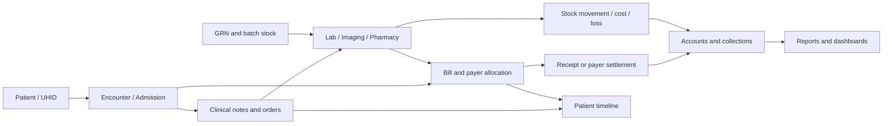

# MGM HMS — Complete section, integration and API walkthrough

Prepared from the current source and final test evidence, 4 October 2026. This is a demonstration and technical reference, not a claim that every requested feature is finished.

## How to read this document

- Page links open the local app on this computer. They need login and the appropriate role. They are not internet-access links.
- API base: `http://localhost:4300/api`. Staff requests use the session issued by `/api/auth/login` (the client sends `X-Session`). Patient portal authentication uses a separate token.
- `GET` reads; `POST` creates or performs an action; `PATCH` updates; `PUT` replaces configured data; `DELETE` removes/cancels the specific supported resource. Do not open mutation endpoints as ordinary links.
- `${id}`, query expressions and other placeholders in the source inventory are templates. Replace them with actual record identifiers; they are not runnable URLs.
- A controller may call shared helpers that make additional requests. The per-page list below shows direct source calls; the backend catalogue includes the registered literal endpoints. It is source wiring evidence, not an OpenAPI contract or proof that every endpoint was independently tested.

## Shared integration model

Action → saved record → related section → status update → accounting/report update where applicable. Clinical status, payment status, order status and sync status remain separate. Patient ID connects the record; encounter ID identifies the visit; admission ID identifies the stay; bill/payment IDs connect money; medicine/batch/location IDs connect stock. Ordinary changes use audit/realtime publishing.

## Verified coverage and open work

Final evidence: 1,191 workflow API checks; 1,832 profile API checks across 24 roles and 70 menu entries; 567 empty-installation checks; server recovery/backup, invoice-series, realtime and quality suites passed. Administrator browser navigation loaded 64 visible menu links. Live database consistency checks passed. Demo data and 24 staff account rows were preserved.

Open work: counselling video and automatic summaries; physical microphone/camera/QR/printer acceptance; separately evidenced language/transcription accuracy; a continuous uptime/load test. SMS/WhatsApp delivery and permanent remote access are on hold. Counselling files are hashed for integrity, not encrypted by the application; review uses authenticated role/doctor checks, not fresh PIN/password confirmation.

## Section-by-section walkthrough

### Overview

**Page flow:** Owner/department dashboard → relevant queue or report. Team chat/tasks, roster and stores are also reachable here. Figures come from operational records, receipts and journal entries; dashboard tabs are limited by role permissions.

Staff logins and permissions → default dashboard → filtered work queues → action on the destination screen → refreshed badges and figures. Chat stores messages/revisions; task assignment stores assignee, due date, progress and reviewer. Material requests go from staff to stores and back to the receiving department.

#### Dashboard

Page: [/dashboard](http://localhost:4300/dashboard). Controller: `client/src/views/dashboard.js`. Menu permission: `signed-in staff`.

Read APIs included in role audit: `/api/dashboard/role`.

Direct controller API calls:

- `GET /api/dashboard/role${qs({ view: f.view, preset: f.preset \|\| undefined, from: f.preset === 'custom' ? (day ? f.to : f.from) : undefined,
        to: f.preset === 'custom' ? f.to : undefined, segment: f.segment, category: f.category, doctor_id: f.doctor_id, mode: f.mode,
        graph: f.graph, gfrom: f.graph === 'custom' ? f.gfrom : undefined, gto: f.graph === 'custom' ? f.gto : undefined, fast: f.fast, slow: f.slow })}`
- `POST /api/pharmacy/prescriptions/${id}/status`
- `POST /api/pharmacy/purchase-requests`
- `POST /api/pharmacy/purchases/${b.dataset.verify}/verify`

#### Team Chat & Tasks

Page: [/staff-workspace](http://localhost:4300/staff-workspace). Controller: `client/src/views/staff-workspace.js`. Menu permission: `signed-in staff`.

Read APIs included in role audit: `/api/staff-work/people`, `/api/staff-work/chat`, `/api/staff-work/tasks`.

Direct controller API calls:

- `GET /api/staff-work/threads/${key}`
- `GET /api/staff-work/chat?thread=${key}${before ? `
- `POST /api/staff-work/threads/${key}/read`
- `GET /api/staff-work/people`
- `GET /api/staff-work/threads`
- `GET /api/staff-work/tasks`
- `POST /api/staff-work/direct`
- `POST /api/staff-work/threads`
- `PATCH /api/staff-work/threads/${thread.id}`
- `POST /api/staff-work/threads/${thread.id}/members`
- `POST /api/staff-work/chat`
- `POST /api/staff-work/tasks`
- `GET /api/staff-work/chat/${history.dataset.history}/history`

#### Roster & Attendance

Page: [/attendance](http://localhost:4300/attendance). Controller: `client/src/views/attendance.js`. Menu permission: `signed-in staff`.

Read APIs included in role audit: `/api/admin/roster`.

Direct controller API calls:

- `GET /api/admin/roster${qs(f)}`
- `POST /api/admin/attendance/punch`
- `POST /api/admin/roster`
- `POST /api/admin/attendance/mark`

Explicit controller page destinations: `/reports?group=`.

#### Stores & Materials

Page: [/stores](http://localhost:4300/stores). Controller: `client/src/views/stores.js`. Menu permission: `signed-in staff`.

Read APIs included in role audit: `/api/stores/meta`, `/api/stores/items`, `/api/stores/requests`.

Direct controller API calls:

- `GET /api/stores/meta`
- `GET /api/stores/requests`
- `GET /api/stores/items?all=1`
- `GET /api/stores/valuation`
- `GET /api/stores/moves`
- `POST /api/stores/requests/${r.id}/reject`
- `POST /api/stores/requests/${r.id}/cancel`
- `POST /api/stores/requests/${r.id}/received`
- `GET /api/stores/items`
- `POST /api/stores/requests`
- `PATCH /api/stores/items/${it.id}`
- `POST /api/stores/items`
- `GET /api/stores/suppliers`
- `POST /api/stores/receipts`
- `POST /api/stores/issues`
- `POST /api/stores/counts`
- `POST /api/stores/transfers`
- `POST /api/stores/returns`

Explicit controller page destinations: `/scan`.

### Reception & OPD

**Page flow:** Patients → Appointments or OP Registration → OP Fee Collection → Vitals Queue → Doctor Queue → Consultation → Service Payments / Pharmacy → Visit Tracking / Follow-up. OPD Procedures & Charges opens the shared bill screen without requiring admission.

Patient ID/UHID remains the identity throughout. Appointment conversion creates an encounter/token. Registration creates one consultation bill using doctor fees. Collection creates a receipt against that bill. Vitals and visit stage are separate from payment status. A free visit is saved before approval. Procedure/lab/imaging charges use the corresponding tariff category and can attribute revenue to the visit doctor or selected billing doctor.

#### Patients

Page: [/patients](http://localhost:4300/patients). Controller: `client/src/views/patients.js`. Menu permission: `patient.view`.

Read APIs included in role audit: `/api/patients`, `/api/patients/stats`.

Direct controller API calls:

- `GET /api/patients${qs({ ...f, limit: 200 })}`
- `GET /api/patients/stats`

Explicit controller page destinations: `/patient/${b.closest('tr').dataset.id}`, `/op-registration?patient=${b.closest('tr').dataset.id}`, `/patient/${p.id}`.

#### Appointments

Page: [/appointments](http://localhost:4300/appointments). Controller: `client/src/views/appointments.js`. Menu permission: `appt.view`.

Read APIs included in role audit: `/api/appointments`.

Direct controller API calls:

- `GET /api/appointments${qs(f)}`
- `PATCH /api/appointments/${id}`
- `POST /api/appointments`

Explicit controller page destinations: `/op-registration?patient=${a.patient_id \|\| ''}&appointment=${id}`.

#### OP Registration

Page: [/op-registration](http://localhost:4300/op-registration). Controller: `client/src/views/op-registration.js`. Menu permission: `op.register`.

Read APIs included in role audit: `/api/queue`.

Direct controller API calls:

- `GET /api/appointments/${ctx.query.appointment}`
- `GET /api/patients/${patientId}`
- `GET /api/queue${qs(f)}`
- `POST /api/encounters/${id}/stage`
- `POST /api/encounters`
- `GET /api/encounters/${e2.id}`
- `GET /api/patients/check/duplicate${qs({ name: form.name.value, mobile: form.mobile.value, age: form.age_years.value })}`
- `GET /api/patients/${b.dataset.use}`
- `POST /api/patients`
- `GET /api/encounters/`

Explicit controller page destinations: `/visit/${id}`, `/vitals-queue?encounter=${id}`, `/visit/${e2.id}`, `/visit/${e.id}`.

#### OP Fee Collection

Page: [/op-fee-collection](http://localhost:4300/op-fee-collection). Controller: `client/src/views/op-fee-collection.js`. Menu permission: `op.collect`.

Read APIs included in role audit: `/api/collection/op`.

Direct controller API calls:

- `GET /api/collection/op${qs(f)}`
- `GET /api/payments/${b.dataset.receipt}/receipt`

Explicit controller page destinations: `/visit/${enc}`.

#### OPD Procedures & Charges

Page: [/bills?new=op](http://localhost:4300/bills?new=op). Controller: `client/src/views/bills.js`. Menu permission: `op.collect`.

Read APIs included in role audit: `/api/bills`.

Direct controller API calls:

- `GET /api/bills${qs({ ...f, limit: 300 })}`
- `GET /api/bills/${id}`
- `GET /api/visiting-doctors?active=1`
- `PATCH /api/bills/${id}/items/${line.id}/visiting`
- `PATCH /api/bills/${id}/doctor`
- `POST /api/bills/${id}/cancel`
- `GET /api/payments/${rec.dataset.rec}/receipt`
- `POST /api/payments/${cp.dataset.cancelPay}/cancel`
- `POST /api/bills/${billId}/items`
- `PATCH /api/bills/${b.id}`
- `GET /api/packages`
- `GET /api/encounters?patient_id=`
- `POST /api/bills`

Explicit controller page destinations: `/insurance`.

#### Service Payments

Page: [/service-payments](http://localhost:4300/service-payments). Controller: `client/src/views/service-payments.js`. Menu permission: `payment.authorize`.

Read APIs included in role audit: `/api/service-queue`.

Direct controller API calls:

- `GET /api/service-queue${qs({ show: f.show === 'cleared' ? 'cleared' : '' })}`

#### Visit Tracking

Page: [/visit-tracking](http://localhost:4300/visit-tracking). Controller: `client/src/views/visit-tracking.js`. Menu permission: `queue.view`.

Read APIs included in role audit: `/api/queue`.

Direct controller API calls:

- `GET /api/queue${qs(f)}`

Explicit controller page destinations: `/visit/${id}`.

#### Vitals Queue

Page: [/vitals-queue](http://localhost:4300/vitals-queue). Controller: `client/src/views/vitals-queue.js`. Menu permission: `vitals.record OR vitals.view OR patient.clinical`.

Read APIs included in role audit: `/api/queue`.

Direct controller API calls:

- `GET /api/queue${qs(f)}`
- `GET /api/encounters/${encounterId}`
- `POST /api/vitals`

Explicit controller page destinations: `/visit/${b.closest('tr').dataset.id}`.

#### Doctor Queue

Page: [/doctor-queue](http://localhost:4300/doctor-queue). Controller: `client/src/views/doctor-queue.js`. Menu permission: `consult.write OR queue.manage`.

Read APIs included in role audit: `/api/queue`.

Direct controller API calls:

- `GET /api/queue${qs(f)}`
- `POST /api/queue/call-next`
- `POST /api/encounters/${id}/stage`

Explicit controller page destinations: `/consultation?encounter=${id}`, `/visit/${id}`.

#### Follow-up

Page: [/follow-up](http://localhost:4300/follow-up). Controller: `client/src/views/follow-up.js`. Menu permission: `queue.view`.

Read APIs included in role audit: `/api/doctor/workspace`, `/api/encounters?kind=OP`.

Direct controller API calls:

- `GET /api/doctor/workspace${qs({ doctor_id: f.doctor_id \|\| state.user.id })}`
- `GET /api/encounters${qs({ kind: 'OP' })}`
- `POST /api/patients/${r.patient_id}/problems`

Explicit controller page destinations: `/patient/${pid}`, `/appointments`, `/op-registration?patient=${pid}`.

#### Queue Display

Page: [/display-queue](http://localhost:4300/display-queue). Controller: `client/src/views/display-queue.js`. Menu permission: `queue.manage`.

Read APIs included in role audit: `/api/queue/display`.

Direct controller API calls:

- `GET /api/queue/display`

### Clinical

**Page flow:** Doctor Queue → Consultation → Clinical Orders → Laboratory / Imaging / Pharmacy → Consultation History / Patient Record. My Templates supplies reusable notes/prescriptions; Certificates issues patient-linked documents. Counselling feeds the patient timeline.

Consultation records refer to patient and encounter. Orders refer to encounter/service and billing lines; prescriptions feed dispensing. Signed notes have amendment controls. Counselling records consent, patient and doctor, audio, transcript and clinician-written summary; doctor review locks it and amendments require a reason. Video and automatic summaries remain unfinished.

#### Consultation

Page: [/consultation](http://localhost:4300/consultation). Controller: `client/src/views/consultation.js`. Menu permission: `consult.write`.

Read APIs included in role audit: `/api/queue`.

Direct controller API calls:

- `GET /api/encounters/${encounterId}`
- `GET /api/templates?kind=consultation`
- `GET /api/queue${qs({ date: todayISO(), doctor_id: doctorId })}`
- `GET /api/patients/${e.patient_id}/timeline`
- `POST /api/consultations`
- `POST /api/templates/${t.id}/use`
- `POST /api/prescriptions`
- `GET /api/payer-rates/patient/${e.patient_id}`
- `POST /api/orders`
- `GET /api/imaging/orders/${orderId}`
- `GET /api/lab/report/${orderId}`

Explicit controller page destinations: `/certificates?patient=${e.patient_id}&encounter=${e.id}`.

#### Consultation History

Page: [/consultation-history](http://localhost:4300/consultation-history). Controller: `client/src/views/consultation-history.js`. Menu permission: `patient.clinical`.

Read APIs included in role audit: `/api/consultations`.

Direct controller API calls:

- `GET /api/consultations${qs(f)}`
- `GET /api/consultations/${id}`

Explicit controller page destinations: `/visit/${b.dataset.enc}`.

#### Counselling

Page: [/counselling](http://localhost:4300/counselling). Controller: `client/src/views/counselling.js`. Menu permission: `counsel.view OR counsel.write OR counsel.review`.

Read APIs included in role audit: `/api/counselling/meta`, `/api/counselling`.

Direct controller API calls:

- `GET /api/counselling/meta`
- `GET /api/counselling`
- `GET /api/patients/${preset.id}`
- `POST /api/counselling`
- `GET /api/counselling/${id}`
- `POST /api/counselling/${id}/transcribe`
- `PATCH /api/counselling/${id}/summary`
- `POST /api/counselling/${id}/review`
- `POST /api/counselling/${id}/amend`

#### Clinical Orders

Page: [/orders](http://localhost:4300/orders). Controller: `client/src/views/orders.js`. Menu permission: `order.view`.

Read APIs included in role audit: `/api/orders`.

Direct controller API calls:

- `GET /api/encounters/${ctx.query.encounter}`
- `GET /api/orders${qs({ ...f, limit: 400 })}`
- `POST /api/orders/${id}/cancel`

Explicit controller page destinations: `/visit/${b.dataset.enc}`.

#### My Templates

Page: [/templates](http://localhost:4300/templates). Controller: `client/src/views/templates.js`. Menu permission: `template.write`.

Read APIs included in role audit: `/api/templates`.

Direct controller API calls:

- `GET /api/templates${qs(f)}`
- `POST /api/templates`

#### Certificates

Page: [/certificates](http://localhost:4300/certificates). Controller: `client/src/views/certificates.js`. Menu permission: `certificate.view`.

Read APIs included in role audit: `/api/certificates`.

Direct controller API calls:

- `GET /api/certificates${qs(f)}`
- `GET /api/patients/${prefill.patient}`
- `PATCH /api/certificates/${c.id}`
- `POST /api/certificates`

### Emergency

**Page flow:** Emergency Desk → ER charges and treatment → Admissions / ICU when admitted, or recorded discharge/referral outcome → Patient Record and Bills. Emergency consumables link to the relevant procedure/bill.

Triage and treatment do not wait for payment. ER records can be linked to a patient; admission and the originating emergency encounter are connected. Charges post receivables/revenue, and actual collection remains a separate event.

#### Emergency Desk

Page: [/emergency](http://localhost:4300/emergency). Controller: `client/src/views/emergency.js`. Menu permission: `emergency.view`.

Read APIs included in role audit: `/api/ipd/emergency`.

Direct controller API calls:

- `GET /api/ipd/emergency${qs({ all: showAll ? 1 : '' })}`
- `GET /api/encounters/${row.encounter_id}`
- `GET /api/ipd/emergency/${r.id}/bill`
- `POST /api/ipd/emergency/${r.id}/charges`
- `POST /api/ipd/emergency/${r.id}/close`
- `POST /api/ipd/emergency/${r.id}/link-patient`
- `POST /api/ipd/emergency`
- `PATCH /api/ipd/emergency/${r.id}`

Explicit controller page destinations: `/patient/${row.patient_id}`, `/consultation?encounter=${row.encounter_id}`.

### IPD

**Page flow:** Admissions & Beds → Nursing / ICU → Ward Indents → Pharmacy IP Requests → Running Bills / Package Utilisation → Discharge → Beds to clean.

Admission stores bed, patient, doctor and payer/package information. Bed changes and configured daily services update running charges. Nursing notes/vitals and medicine administration stay linked to the admission. Indents create pharmacy requisitions; issue deducts batch stock and links IP charges. Discharge checks clinical/financial readiness and package reconciliation; housekeeping marks the bed ready for reuse. Changing payer updates the existing case rather than creating a second patient.

#### Admissions & Beds

Page: [/admissions](http://localhost:4300/admissions). Controller: `client/src/views/admissions.js`. Menu permission: `ipd.view`.

Read APIs included in role audit: `/api/ipd/beds`, `/api/ipd/admissions`.

Direct controller API calls:

- `GET /api/ipd/beds`
- `GET /api/ipd/admissions${qs(f)}`
- `GET /api/packages`
- `POST /api/ipd/admissions/${a.id}/package`
- `GET /api/ipd/admissions/${id}`
- `POST /api/ipd/nursing/mar/${give.dataset.give}`
- `POST /api/ipd/admissions/${a.id}/charges/${stop.dataset.stopCharge}/stop`
- `POST /api/bills/${waive.dataset.bill}/items/${waive.dataset.waive}/waive`
- `GET /api/encounters/${a.encounter_id}`
- `GET /api/payers`
- `PATCH /api/ipd/admissions/${id}/payer`
- `PATCH /api/ipd/admissions/${a.id}`
- `GET /api/ipd/charge-catalog`
- `POST /api/ipd/admissions/${a.id}/charges`
- `POST /api/ipd/nursing/notes`
- `PATCH /api/ipd/beds/${bed.id}`
- `GET /api/patients/${patientId}`
- `POST /api/ipd/admissions`

Explicit controller page destinations: `/consultation?encounter=${a.encounter_id}`, `/discharge`.

#### Nursing

Page: [/nursing](http://localhost:4300/nursing). Controller: `client/src/views/nursing.js`. Menu permission: `nursing.view OR patient.clinical`.

Read APIs included in role audit: `/api/ipd/nursing/board`.

Direct controller API calls:

- `GET /api/ipd/nursing/board${qs(f)}`
- `GET /api/ipd/admissions/${admissionId}`
- `GET /api/ipd/admissions/${admissionId}/med-orders`
- `POST /api/ipd/nursing/mar/${b.dataset.give}`
- `POST /api/ipd/admissions/${admissionId}/mar/from-orders`
- `POST /api/ipd/nursing/mar`
- `POST /api/ipd/nursing/notes`
- `GET /api/ipd/admissions/${row.admission_id}`
- `POST /api/vitals`

#### Ward Indents

Page: [/indents](http://localhost:4300/indents). Controller: `client/src/views/indents.js`. Menu permission: `ipd.indent`.

Read APIs included in role audit: `/api/pharmacy/indents`.

Direct controller API calls:

- `GET /api/pharmacy/indents${qs({ status: f.status })}`
- `POST /api/pharmacy/indents/${b.dataset.issue}/dispense`
- `POST /api/pharmacy/indents/${b.dataset.cancel}/cancel`
- `GET /api/ipd/admissions?status=active`
- `GET /api/pharmacy/medicines?limit=1000&location=IP`
- `POST /api/pharmacy/indents`

#### ICU

Page: [/icu](http://localhost:4300/icu). Controller: `client/src/views/icu.js`. Menu permission: `nursing.view OR patient.clinical`.

Read APIs included in role audit: `/api/ipd/icu`.

Direct controller API calls:

- `GET /api/ipd/icu`

Explicit controller page destinations: `/patient/${b.dataset.open}`.

#### Discharge

Page: [/discharge](http://localhost:4300/discharge). Controller: `client/src/views/discharge.js`. Menu permission: `ipd.view`.

Read APIs included in role audit: `/api/ipd/discharge/board`.

Direct controller API calls:

- `GET /api/ipd/discharge/board`
- `GET /api/ipd/discharges${qs({ q: past.q, from: past.from })}`
- `GET /api/ipd/admissions/${id}`
- `PATCH /api/ipd/admissions/${id}`
- `GET /api/ipd/admissions/${row.id}`
- `POST /api/ipd/admissions/${row.id}/discharge`
- `POST /api/refunds`

#### Beds to clean

Page: [/housekeeping](http://localhost:4300/housekeeping). Controller: `client/src/views/housekeeping.js`. Menu permission: `beds.clean OR ipd.manage`.

Read APIs included in role audit: `/api/ipd/housekeeping`.

Direct controller API calls:

- `GET /api/ipd/housekeeping`
- `POST /api/ipd/beds/${b.closest('tr').dataset.bed}/cleaned`

### Diagnostics

**Page flow:** Clinical Orders → Service Payments or payer authorisation → Laboratory / Imaging → USG Reporting when applicable → Verified/signed report → Consultation, Patient Record and Patient Portal.

Lab specimens/results refer to orders and patient identity. Parameters provide reference ranges and abnormal flags. Imaging reports and attachments refer to imaging orders. Report access and verification are role-controlled. Report-ready messages can be queued, but external delivery is on hold.

#### Laboratory

Page: [/laboratory](http://localhost:4300/laboratory). Controller: `client/src/views/laboratory.js`. Menu permission: `lab.view`.

Read APIs included in role audit: `/api/lab/worklist`, `/api/lab/stats`.

Direct controller API calls:

- `GET /api/lab/worklist${qs(f)}`
- `GET /api/lab/stats`
- `POST /api/lab/orders/${id}/collect`
- `PATCH /api/orders/${id}`
- `POST /api/lab/orders/${id}/verify`
- `GET /api/lab/orders/${orderId}`
- `POST /api/lab/orders/${orderId}/results`
- `GET /api/lab/report/${orderId}`

#### Imaging

Page: [/imaging](http://localhost:4300/imaging). Controller: `client/src/views/imaging.js`. Menu permission: `imaging.view`.

Read APIs included in role audit: `/api/imaging/worklist`.

Direct controller API calls:

- `GET /api/imaging/worklist${qs(f)}`
- `PATCH /api/orders/${id}`
- `POST /api/imaging/orders/${id}/schedule`
- `GET /api/imaging/orders/${orderId}`
- `POST /api/imaging/orders/${orderId}/report`

#### USG Reporting

Page: [/usg-reporting](http://localhost:4300/usg-reporting). Controller: `client/src/views/usg-reporting.js`. Menu permission: `imaging.report`.

Read APIs included in role audit: `/api/imaging/worklist?modality=USG`.

Direct controller API calls:

- `GET /api/imaging/worklist${qs({ ...f, modality: 'USG' })}`
- `GET /api/templates?kind=usg`

### Pharmacy

**Page flow:** Medicine Master / Suppliers → Purchases / GRN → Central stock → Stock Transfers → OP/IP/ER/ICU/OT location → Sales & Dispensing or IP Requests → Bills / Receipts / Handover. Returns and stock write-offs feed analytics and accounts.

Each supplier invoice is a separate GRN with multiple medicines, brands, generics, batches and unit conversions. Existing batch prices are available in price history; variances create acknowledgement/escalation alerts. Dispensing uses batch quantities and expiry selection. Self-pay collection differs from payer-covered dues. Patient package details/utilisation are shown for linked treatment. Ward stock and expiry/loss movements remain traceable through reports.

#### Sales & Dispensing

Page: [/pharmacy](http://localhost:4300/pharmacy). Controller: `client/src/views/pharmacy.js`. Menu permission: `pharmacy.view`.

Read APIs included in role audit: `/api/pharmacy/dispense/queue`.

Direct controller API calls:

- `GET /api/pharmacy/dispense/queue`
- `GET /api/patients/${rx.patient_id}`
- `GET /api/pharmacy/batches?medicine_id=${item.medicine_id}&location=${store()}`
- `GET /api/ipd/admissions${qs({ q: p.uhid })}`
- `GET /api/pharmacy/medicines${qs({ q, limit: 20, active: 1, location: store() })}`
- `GET /api/pharmacy/batches?medicine_id=${b.dataset.m}&location=${store()}`
- `GET /api/pharmacy/medicines/${b.dataset.m}`
- `POST /api/pharmacy/dispense`
- `GET /api/payments/${r.payment.id}/receipt`
- `GET /api/pharmacy/patient-package/${currentPatient}`

#### IP Requests

Page: [/indents](http://localhost:4300/indents). Controller: `client/src/views/indents.js`. Menu permission: `pharmacy.dispense`.

Read APIs included in role audit: `/api/pharmacy/indents`.

Direct controller API calls:

- `GET /api/pharmacy/indents${qs({ status: f.status })}`
- `POST /api/pharmacy/indents/${b.dataset.issue}/dispense`
- `POST /api/pharmacy/indents/${b.dataset.cancel}/cancel`
- `GET /api/ipd/admissions?status=active`
- `GET /api/pharmacy/medicines?limit=1000&location=IP`
- `POST /api/pharmacy/indents`

#### ER / ICU / OT Stock

Page: [/reports?report=emergency_store_batches](http://localhost:4300/reports?report=emergency_store_batches). Controller: `client/src/views/reports.js`. Menu permission: `reports.pharmacy`.

Read APIs included in role audit: `/api/reports/catalog`.

Direct controller API calls:

- `GET /api/reports/catalog`
- `GET /api/reports/run/${f.id}${qs({ preset, from: preset === 'custom' ? (f.from \|\| f.to) : undefined, to: preset === 'custom' ? f.to : undefined,
        segment: f.segment, category: f.category, mode: f.mode, doctor_id: f.doctor_id, account_id: f.account_id })}`

#### Stock

Page: [/stock](http://localhost:4300/stock). Controller: `client/src/views/stock.js`. Menu permission: `inventory.view`.

Read APIs included in role audit: `/api/pharmacy/stock`, `/api/pharmacy/stock/moves`.

Direct controller API calls:

- `GET /api/pharmacy/stock${qs(f)}`
- `GET /api/pharmacy/stock/moves`

#### Stock Transfers

Page: [/stock-transfers](http://localhost:4300/stock-transfers). Controller: `client/src/views/stock-transfers.js`. Menu permission: `inventory.view`.

Read APIs included in role audit: `/api/pharmacy/transfers`, `/api/pharmacy/locations`.

Direct controller API calls:

- `GET /api/pharmacy/transfers${qs(f)}`
- `GET /api/pharmacy/locations`
- `GET /api/pharmacy/medicines?limit=1000`
- `GET /api/pharmacy/medicines?limit=1000&location=${src}`
- `POST /api/pharmacy/transfers`
- `GET /api/pharmacy/transfers/${id}`
- `POST /api/pharmacy/transfers/${t.id}/${act}`

#### Purchases / GRN

Page: [/grn](http://localhost:4300/grn). Controller: `client/src/views/grn.js`. Menu permission: `purchase.view`.

Read APIs included in role audit: `/api/pharmacy/purchases`.

Direct controller API calls:

- `GET /api/pharmacy/purchases${qs(f)}`
- `GET /api/price-alerts`
- `POST /api/price-alerts/acknowledge`
- `POST /api/price-alerts/${b.closest('tr').dataset.aid}/escalate`
- `GET /api/pharmacy/purchases/${id}`

#### Returns

Page: [/returns](http://localhost:4300/returns). Controller: `client/src/views/returns.js`. Menu permission: `pharmacy.view OR purchase.view`.

Direct controller API calls:

- `GET /api/pharmacy/sales-returns`
- `GET /api/pharmacy/purchase-returns`
- `GET /api/bills${qs({ q, limit: 20 })}`
- `GET /api/bills/${b.dataset.bill}`
- `POST /api/pharmacy/sales-returns`
- `GET /api/pharmacy/stock?location=Central`
- `POST /api/pharmacy/purchase-returns`

#### Medicine Master

Page: [/medicines](http://localhost:4300/medicines). Controller: `client/src/views/medicines.js`. Menu permission: `inventory.view`.

Read APIs included in role audit: `/api/pharmacy/medicines`.

Direct controller API calls:

- `GET /api/pharmacy/medicines${qs({ ...f, limit: 400 })}`
- `GET /api/pharmacy/medicines/${id}`
- `POST /api/pharmacy/stock/adjust`
- `PATCH /api/pharmacy/medicines/${m.id}`
- `POST /api/pharmacy/medicines`

#### Suppliers

Page: [/suppliers](http://localhost:4300/suppliers). Controller: `client/src/views/suppliers.js`. Menu permission: `supplier.view`.

Read APIs included in role audit: `/api/pharmacy/suppliers`.

Direct controller API calls:

- `GET /api/pharmacy/suppliers${qs(f)}`
- `POST /api/pharmacy/suppliers`

#### Daily Sales & Handover

Page: [/day-report?desk=pharmacy](http://localhost:4300/day-report?desk=pharmacy). Controller: `client/src/views/day-report.js`. Menu permission: `pharmacy.view`. Shortcut hidden when `reports.collection` already provides the broader screen.

Read APIs included in role audit: `/api/desk/day`, `/api/desk/handover`, `/api/desk/shifts`.

Direct controller API calls:

- `GET /api/desk/day${qs({ desk: f.desk, date: f.date, user_id: f.user_id })}`
- `GET /api/desk/handover${qs({ desk: f.desk, date: f.date })}`
- `POST /api/desk/handover`
- `POST /api/desk/handover/${b.dataset.accept \|\| b.dataset.dispute}/verify`
- `GET /api/desk/shifts${qs({desk:f.desk})}`
- `POST /api/desk/shifts`
- `POST /api/desk/shifts/${b.dataset.shiftAccept}/accept`

#### Pharmacy Analytics

Page: [/pharmacy-reports](http://localhost:4300/pharmacy-reports). Controller: `client/src/views/pharmacy-reports.js`. Menu permission: `pharmacy.view`.

Read APIs included in role audit: `/api/pharmacy/analytics`.

Direct controller API calls:

- `GET /api/pharmacy/analytics${qs(f)}`

#### Pharmacy Reports

Page: [/reports?group=Pharmacy](http://localhost:4300/reports?group=Pharmacy). Controller: `client/src/views/reports.js`. Menu permission: `reports.pharmacy`. Shortcut hidden when `reports.view` already provides the broader screen.

Read APIs included in role audit: `/api/reports/catalog`.

Direct controller API calls:

- `GET /api/reports/catalog`
- `GET /api/reports/run/${f.id}${qs({ preset, from: preset === 'custom' ? (f.from \|\| f.to) : undefined, to: preset === 'custom' ? f.to : undefined,
        segment: f.segment, category: f.category, mode: f.mode, doctor_id: f.doctor_id, account_id: f.account_id })}`

### OT & Maternity

**Page flow:** OT Schedule → surgical team including visiting doctors → procedure charges/consumables → IP/OP bill → visiting-doctor ledger. Maternity → Partograph → delivery/outcome record → Patient Record.

OT charges distinguish hospital charges from attributed outside-doctor fees. Procedure kits track consumables and prevent/flag duplicate charges. Maternity observations belong to the case and patient; they are clinical records, not a separate patient identity.

#### OT Schedule

Page: [/ot](http://localhost:4300/ot). Controller: `client/src/views/ot.js`. Menu permission: `ot.view`.

Read APIs included in role audit: `/api/ipd/ot`.

Direct controller API calls:

- `GET /api/ipd/ot${qs(f)}`
- `PATCH /api/ipd/ot/${id}`
- `PATCH /api/ipd/ot/${r.id}`
- `GET /api/visiting-doctors?active=1`
- `POST /api/ipd/ot`

#### Maternity

Page: [/maternity](http://localhost:4300/maternity). Controller: `client/src/views/maternity.js`. Menu permission: `maternity.view`.

Read APIs included in role audit: `/api/ipd/maternity`.

Direct controller API calls:

- `GET /api/ipd/maternity${qs(f)}`
- `PATCH /api/ipd/maternity/${r.id}`
- `POST /api/ipd/maternity`

Explicit controller page destinations: `/partograph?case=${id}`, `/patient/${cache.find((x) => x.id === id).patient_id}`.

#### Partograph

Page: [/partograph](http://localhost:4300/partograph). Controller: `client/src/views/partograph.js`. Menu permission: `maternity.view`.

Read APIs included in role audit: `/api/ipd/maternity`.

Direct controller API calls:

- `GET /api/ipd/maternity`
- `GET /api/ipd/maternity/${caseId}`
- `POST /api/ipd/maternity/${c.id}/partograph`

### Billing & Insurance

**Page flow:** Bills → Receipts / Refunds → Daily Collection & Handover → Accounts. Payers & TPAs / Packages → Insurance & Payer Cases → coverage/exclusions/copay → Payer Receivables → settlement. Approvals handles free treatment; Patient Messages queues reminders/report-ready messages.

Bill creation recognises revenue and a receivable. Cash/UPI/card collection reduces that receivable; payer approval is not money received. Patient-pay exclusions and copays stay separately payable. Self-pay, TPA, Aarogyasri, corporate, trust and credit use distinct new invoice series. Common hospital packages and payer agreement packages are both supported. Package reconciliation offsets included charges and leaves applicable excess/excluded charges payable. Pending handover cash remains with the desk until the receiver accepts it.

#### Approvals

Page: [/approvals](http://localhost:4300/approvals). Controller: `client/src/views/approvals.js`. Menu permission: `payment.approve_free`.

Read APIs included in role audit: `/api/approvals`.

Direct controller API calls:

- `GET /api/approvals`
- `POST /api/approvals/${b.dataset.approve}/approve`
- `POST /api/approvals/${b.dataset.reject}/reject`

#### Daily Collection & Handover

Page: [/day-report](http://localhost:4300/day-report). Controller: `client/src/views/day-report.js`. Menu permission: `reports.collection`.

Read APIs included in role audit: `/api/desk/day`, `/api/desk/handover`, `/api/desk/shifts`.

Direct controller API calls:

- `GET /api/desk/day${qs({ desk: f.desk, date: f.date, user_id: f.user_id })}`
- `GET /api/desk/handover${qs({ desk: f.desk, date: f.date })}`
- `POST /api/desk/handover`
- `POST /api/desk/handover/${b.dataset.accept \|\| b.dataset.dispute}/verify`
- `GET /api/desk/shifts${qs({desk:f.desk})}`
- `POST /api/desk/shifts`
- `POST /api/desk/shifts/${b.dataset.shiftAccept}/accept`

#### Reception Reports

Page: [/reports?group=Reception](http://localhost:4300/reports?group=Reception). Controller: `client/src/views/reports.js`. Menu permission: `reports.reception`. Shortcut hidden when `reports.view` already provides the broader screen.

Read APIs included in role audit: `/api/reports/catalog`.

Direct controller API calls:

- `GET /api/reports/catalog`
- `GET /api/reports/run/${f.id}${qs({ preset, from: preset === 'custom' ? (f.from \|\| f.to) : undefined, to: preset === 'custom' ? f.to : undefined,
        segment: f.segment, category: f.category, mode: f.mode, doctor_id: f.doctor_id, account_id: f.account_id })}`

#### Bills

Page: [/bills](http://localhost:4300/bills). Controller: `client/src/views/bills.js`. Menu permission: `payment.view OR payment.collect OR finance.view OR insurance.view`.

Read APIs included in role audit: `/api/bills`.

Direct controller API calls:

- `GET /api/bills${qs({ ...f, limit: 300 })}`
- `GET /api/bills/${id}`
- `GET /api/visiting-doctors?active=1`
- `PATCH /api/bills/${id}/items/${line.id}/visiting`
- `PATCH /api/bills/${id}/doctor`
- `POST /api/bills/${id}/cancel`
- `GET /api/payments/${rec.dataset.rec}/receipt`
- `POST /api/payments/${cp.dataset.cancelPay}/cancel`
- `POST /api/bills/${billId}/items`
- `PATCH /api/bills/${b.id}`
- `GET /api/packages`
- `GET /api/encounters?patient_id=`
- `POST /api/bills`

Explicit controller page destinations: `/insurance`.

#### Receipts & Refunds

Page: [/receipts](http://localhost:4300/receipts). Controller: `client/src/views/receipts.js`. Menu permission: `payment.view`.

Read APIs included in role audit: `/api/payments`.

Direct controller API calls:

- `GET /api/payments${qs({ ...f, limit: 500 })}`
- `GET /api/refunds`
- `GET /api/payments/${b.dataset.print}/receipt`
- `POST /api/payments/${b.dataset.cancel}/cancel`
- `POST /api/refunds`

#### Insurance & Payer Cases

Page: [/insurance](http://localhost:4300/insurance). Controller: `client/src/views/insurance.js`. Menu permission: `insurance.view`.

Read APIs included in role audit: `/api/insurance/claims`, `/api/payers`, `/api/packages`.

Direct controller API calls:

- `GET /api/payers`
- `GET /api/packages`
- `GET /api/insurance/claims${qs(f)}`
- `GET /api/insurance/claims/${c.id}/lines`
- `PUT /api/insurance/claims/${c.id}/exclusions`
- `PATCH /api/insurance/claims/${c.id}`
- `POST /api/insurance/claims`

Explicit controller page destinations: `/payers`, `/packages`.

#### Payers & TPAs

Page: [/payers](http://localhost:4300/payers). Controller: `client/src/views/payers.js`. Menu permission: `insurance.view`.

Read APIs included in role audit: `/api/payers`.

Direct controller API calls:

- `GET /api/payers${showAll ? '?all=1' : ''}`
- `PATCH /api/payers/${p.id}`
- `POST /api/payers`
- `GET /api/payers/${id}`
- `GET /api/services`
- `PUT /api/payers/${p.id}/rates`

#### Patient Messages

Page: [/messages](http://localhost:4300/messages). Controller: `client/src/views/messages.js`. Menu permission: `payment.collect OR finance.view OR admin.view`.

Read APIs included in role audit: `/api/messages`.

Direct controller API calls:

- `GET /api/messages${qs(f)}`
- `POST /api/messages/${b.dataset.sent}/sent`
- `POST /api/messages/${b.dataset.retry}/retry`
- `POST /api/messages`

#### Packages

Page: [/packages](http://localhost:4300/packages). Controller: `client/src/views/packages.js`. Menu permission: `op.register OR insurance.view OR admin.view`.

Read APIs included in role audit: `/api/packages`.

Direct controller API calls:

- `GET /api/packages`
- `GET /api/package-assignments?status=active`
- `GET /api/payer-packages/${id}`
- `GET /api/payers`
- `GET /api/services`
- `PATCH /api/payer-packages/${p.id}`
- `POST /api/payer-packages`
- `GET /api/encounters?patient_id=${x.id}`
- `POST /api/bills`

Explicit controller page destinations: `/payers`.

### Finance

**Page flow:** Operational bills/receipts/stock/expenses → Accounts journals → ledgers/trial balance/P&L/balance sheet. Payer Receivables records payer money. Counter Reconciliation and day close review counters. Visiting Doctors creates share statements and payouts.

Shared accounting rules post balanced vouchers. Expenses have approval/duplicate controls. Collections, refunds, supplier payments, stock cost and losses affect the appropriate accounts. Visiting-doctor share is earned on actual money received, adjusted for refunds; statement accrual and payout/TDS are separate. Day close enforces transaction-date locks with authorised reopening.

#### Accounts

Page: [/accounts](http://localhost:4300/accounts). Controller: `client/src/views/accounts.js`. Menu permission: `finance.view`.

Read APIs included in role audit: `/api/accounts/position`.

Direct controller API calls:

- `GET /api/accounts/position`
- `GET /api/accounts/integrity`
- `POST /api/accounts/integrity/correct`
- `GET /api/accounts/journals${qs({ preset: f.preset, type: f.jtype, q: f.jq })}`
- `GET /api/accounts/journals/${id}`
- `POST /api/accounts/journals/${v.id}/reverse`
- `GET /api/accounts/chart`
- `POST /api/accounts/journals`
- `POST /api/accounts/contra`
- `GET /api/accounts/ledger${qs({ account_id: f.account_id, preset: f.preset })}`
- `GET /api/accounts/receivables${qs({ mode: f.rmode, status: f.rstatus \|\| 'open', q: f.rq })}`
- `POST /api/accounts/receivables/${b.dataset.cancelS}/cancel`
- `POST /api/accounts/receivables/${s.id}/receive`
- `GET /api/pharmacy/payables`
- `GET /api/pharmacy/supplier-payments`
- `POST /api/pharmacy/supplier-payments`
- `GET /api/accounts/day-close?date=${date}`
- `GET /api/accounts/day-closings`
- `POST /api/accounts/day-close`
- `POST /api/accounts/day-close/${date}/approve`
- `POST /api/accounts/day-close/${date}/reopen`
- `GET /api/accounts/reconciliation${qs({ preset: f.preset })}`
- `GET /api/accounts/chart${qs({ preset: 'year' })}`
- `POST /api/accounts/chart`

#### Payer Receivables

Page: [/accounts?tab=receivables](http://localhost:4300/accounts?tab=receivables). Controller: `client/src/views/accounts.js`. Menu permission: `finance.receivables`. Shortcut hidden when `finance.view` already provides the broader screen.

Read APIs included in role audit: `/api/accounts/position`.

Direct controller API calls:

- `GET /api/accounts/position`
- `GET /api/accounts/integrity`
- `POST /api/accounts/integrity/correct`
- `GET /api/accounts/journals${qs({ preset: f.preset, type: f.jtype, q: f.jq })}`
- `GET /api/accounts/journals/${id}`
- `POST /api/accounts/journals/${v.id}/reverse`
- `GET /api/accounts/chart`
- `POST /api/accounts/journals`
- `POST /api/accounts/contra`
- `GET /api/accounts/ledger${qs({ account_id: f.account_id, preset: f.preset })}`
- `GET /api/accounts/receivables${qs({ mode: f.rmode, status: f.rstatus \|\| 'open', q: f.rq })}`
- `POST /api/accounts/receivables/${b.dataset.cancelS}/cancel`
- `POST /api/accounts/receivables/${s.id}/receive`
- `GET /api/pharmacy/payables`
- `GET /api/pharmacy/supplier-payments`
- `POST /api/pharmacy/supplier-payments`
- `GET /api/accounts/day-close?date=${date}`
- `GET /api/accounts/day-closings`
- `POST /api/accounts/day-close`
- `POST /api/accounts/day-close/${date}/approve`
- `POST /api/accounts/day-close/${date}/reopen`
- `GET /api/accounts/reconciliation${qs({ preset: f.preset })}`
- `GET /api/accounts/chart${qs({ preset: 'year' })}`
- `POST /api/accounts/chart`

#### Expenses

Page: [/expenses](http://localhost:4300/expenses). Controller: `client/src/views/expenses.js`. Menu permission: `expense.view`.

Read APIs included in role audit: `/api/finance/expenses`, `/api/finance/expense-accounts`.

Direct controller API calls:

- `GET /api/finance/expenses${qs(f)}`
- `PATCH /api/finance/expenses/${id}`
- `POST /api/finance/expenses`

#### Visiting Doctors

Page: [/visiting-doctors](http://localhost:4300/visiting-doctors). Controller: `client/src/views/visiting-doctors.js`. Menu permission: `finance.view OR admin.view`.

Read APIs included in role audit: `/api/visiting-doctors`.

Direct controller API calls:

- `GET /api/visiting-doctors`
- `PATCH /api/visiting-doctors/${d.id}`
- `POST /api/visiting-doctors`
- `GET /api/visiting-doctors/${id}/ledger`
- `POST /api/visiting-doctors/${id}/statements`
- `POST /api/visiting-doctors/${d.id}/payouts`

#### Counter Reconciliation

Page: [/counter-reconciliation](http://localhost:4300/counter-reconciliation). Controller: `client/src/views/counter-reconciliation.js`. Menu permission: `finance.counter`.

Read APIs included in role audit: `/api/counters/sessions`.

Direct controller API calls:

- `GET /api/counters/sessions${qs(f)}`
- `POST /api/counters/sessions`
- `POST /api/counters/sessions/${sessionId}/close`

### Reports

**Page flow:** Report Centre or department report shortcut → permitted catalogue → date/filter selection → report data/chart/table → Excel/CSV/print/PDF action.

Reports read the same patient, encounter, billing, payer, medicine batch, movement and accounting records used by operating screens. Revenue, collections and outstanding dues are different measures. The audit exercised permitted report endpoints, including package/visiting/stores/ward stock reports; every export layout and physical printer has not been independently tested.

#### Report Centre

Page: [/reports](http://localhost:4300/reports). Controller: `client/src/views/reports.js`. Menu permission: `reports.view`.

Read APIs included in role audit: `/api/reports/catalog`.

Direct controller API calls:

- `GET /api/reports/catalog`
- `GET /api/reports/run/${f.id}${qs({ preset, from: preset === 'custom' ? (f.from \|\| f.to) : undefined, to: preset === 'custom' ? f.to : undefined,
        segment: f.segment, category: f.category, mode: f.mode, doctor_id: f.doctor_id, account_id: f.account_id })}`

### Administration

**Page flow:** Users & Roles / Fees & Tariffs / Wards & Beds / Hospital Settings → operating screens. Audit Trail / Quality / Local Setup & Sync / My Access provide oversight. Attendance Reports links to roster data.

Doctor department and consultation tariff belong to the staff/master setup. Department staff and in-charge roles have different access. Both sidebar and backend permissions matter; hiding a menu alone is not security. Service prices are shared across orders/bills; ward/bed setup feeds admissions. Backups and health operate locally. Cloud delivery/sync and permanent remote access are not certified by local checks.

#### Users & Roles

Page: [/users](http://localhost:4300/users). Controller: `client/src/views/users.js`. Menu permission: `admin.view OR staff.manage`.

Read APIs included in role audit: `/api/admin/users`, `/api/admin/roles`.

Direct controller API calls:

- `GET /api/admin/users`
- `GET /api/admin/roles`
- `PATCH /api/admin/users/${u.id}`
- `POST /api/admin/users`
- `PUT /api/admin/roles/${r.role}`
- `POST /api/admin/roles/${r.role}/reset`
- `POST /api/admin/roles`

#### Hospital Settings

Page: [/settings](http://localhost:4300/settings). Controller: `client/src/views/settings.js`. Menu permission: `admin.view`.

Read APIs included in role audit: `/api/settings`, `/api/system/backups`.

Direct controller API calls:

- `GET /api/settings`
- `GET /api/system/backups`
- `POST /api/system/backups/now`
- `GET /api/admin/demo-mode`
- `POST /api/admin/demo-mode`
- `PATCH /api/settings`

#### Fees & Tariffs

Page: [/tariff](http://localhost:4300/tariff). Controller: `client/src/views/tariff.js`. Menu permission: `admin.view`.

Read APIs included in role audit: `/api/services`, `/api/admin/users`.

Direct controller API calls:

- `GET /api/services`
- `GET /api/admin/users`
- `GET /api/lab/params?service_id=${s.id}`
- `POST /api/lab/params`
- `PATCH /api/services/${s.id}`
- `POST /api/services`
- `PATCH /api/admin/users/${d.id}`

#### Wards & Beds

Page: [/wards](http://localhost:4300/wards). Controller: `client/src/views/wards.js`. Menu permission: `admin.view`.

Read APIs included in role audit: `/api/ipd/wards`.

Direct controller API calls:

- `GET /api/ipd/wards`
- `PATCH /api/ipd/beds/${b.dataset.block}`
- `PATCH /api/ipd/wards/${w.id}`
- `POST /api/ipd/wards`
- `POST /api/ipd/wards/${w.id}/beds`
- `PATCH /api/ipd/beds/${b.id}`

#### Attendance Reports

Page: [/reports?group=Staff%20%26%20HR](http://localhost:4300/reports?group=Staff%20%26%20HR). Controller: `client/src/views/reports.js`. Menu permission: `reports.attendance`. Shortcut hidden when `reports.view` already provides the broader screen.

Read APIs included in role audit: `/api/reports/catalog`.

Direct controller API calls:

- `GET /api/reports/catalog`
- `GET /api/reports/run/${f.id}${qs({ preset, from: preset === 'custom' ? (f.from \|\| f.to) : undefined, to: preset === 'custom' ? f.to : undefined,
        segment: f.segment, category: f.category, mode: f.mode, doctor_id: f.doctor_id, account_id: f.account_id })}`

#### Audit Trail

Page: [/audit](http://localhost:4300/audit). Controller: `client/src/views/audit.js`. Menu permission: `audit.view`.

Read APIs included in role audit: `/api/audit`.

Direct controller API calls:

- `GET /api/audit${qs({ ...f, limit: 1000 })}`

#### Quality

Page: [/quality](http://localhost:4300/quality). Controller: `client/src/views/quality.js`. Menu permission: `quality.view`.

Read APIs included in role audit: `/api/quality`.

Direct controller API calls:

- `GET /api/quality${qs(f)}`
- `GET /api/audit?limit=60`
- `PATCH /api/quality/${q.id}`
- `POST /api/quality`

#### Local Setup & Sync

Page: [/local-sync](http://localhost:4300/local-sync). Controller: `client/src/views/local-sync.js`. Menu permission: `admin.view`.

Read APIs included in role audit: `/api/sync`, `/api/system/health`.

Direct controller API calls:

- `GET /api/sync`
- `GET /api/system/health`
- `POST /api/sync/flush`
- `POST /api/sync/retry/${b.dataset.retry}`

#### My Access

Page: [/my-access](http://localhost:4300/my-access). Controller: `client/src/views/my-access.js`. Menu permission: `signed-in staff`.

Read APIs included in role audit: `/api/admin/access/me`, `/api/system/health`.

Direct controller API calls:

- `GET /api/admin/access/me`
- `GET /api/system/health`

## Internal screens and extra entry points

### Patient Record

Page pattern: [/patient](http://localhost:4300/patient). Patient/visit screens need a record identifier; opening the bare route may show a selection prompt.

- `GET /api/patients/${id}/timeline`
- `GET /api/patients/${p.id}/portal-access`
- `POST /api/patients/${p.id}/portal-access`
- `POST /api/patients/${p.id}/portal-access/revoke`
- `POST /api/patients/${id}/allergies`
- `PATCH /api/patients/${p.id}`

### Visit

Page pattern: [/visit](http://localhost:4300/visit). Patient/visit screens need a record identifier; opening the bare route may show a selection prompt.

- `GET /api/encounters/${id}`
- `GET /api/payments/${b.dataset.printReceipt}/receipt`
- `POST /api/encounters/${e.id}/stage`
- `POST /api/encounters/${e.id}/free`

### Doctor OPD Consultation

Page pattern: [/doctor-consultation](http://localhost:4300/doctor-consultation). Patient/visit screens need a record identifier; opening the bare route may show a selection prompt.

### Waiting Room Display

Page pattern: [/display-waiting](http://localhost:4300/display-waiting). Patient/visit screens need a record identifier; opening the bare route may show a selection prompt.

### Patient Portal

Page pattern: [/portal](http://localhost:4300/portal). Patient/visit screens need a record identifier; opening the bare route may show a selection prompt.

- `GET /api/patients/${patientId}/timeline`

### Collections

Page pattern: [/collections](http://localhost:4300/collections). Patient/visit screens need a record identifier; opening the bare route may show a selection prompt.

- `GET /api/payments${qs({ ...f, limit: 400 })}`
- `GET /api/bills${qs({ status: 'outstanding', limit: 120 })}`
- `GET /api/payments/${b.dataset.print}/receipt`

### Sign in

Page pattern: [/login](http://localhost:4300/login). Patient/visit screens need a record identifier; opening the bare route may show a selection prompt.

Additional patient-facing portal: [My Health](http://localhost:4300/my-health). Material label entry: [Scan](http://localhost:4300/scan), normally opened with the item code in `?c=...`. These are extra entry points beyond the sidebar/internal route list.

## Roles, dashboards and permitted menus

Configured permissions may be edited; these are the default-role audit results. A read permission does not imply permission to approve, collect, verify or modify.

### admin

Default dashboard: `owner`. Available dashboard views: `reception`, `doctor`, `pharmacy`, `lab`, `nurse`, `owner`, `insurance`, `quality`, `work`. Reports available in the audited catalogue: 140.

Permitted menu routes: `/dashboard`, `/staff-workspace`, `/attendance`, `/stores`, `/patients`, `/appointments`, `/op-registration`, `/op-fee-collection`, `/bills?new=op`, `/service-payments`, `/visit-tracking`, `/vitals-queue`, `/doctor-queue`, `/follow-up`, `/display-queue`, `/consultation`, `/consultation-history`, `/counselling`, `/orders`, `/templates`, `/certificates`, `/emergency`, `/admissions`, `/nursing`, `/indents`, `/icu`, `/discharge`, `/housekeeping`, `/laboratory`, `/imaging`, `/usg-reporting`, `/pharmacy`, `/indents`, `/reports?report=emergency_store_batches`, `/stock`, `/stock-transfers`, `/grn`, `/returns`, `/medicines`, `/suppliers`, `/pharmacy-reports`, `/ot`, `/maternity`, `/partograph`, `/approvals`, `/day-report`, `/bills`, `/receipts`, `/insurance`, `/payers`, `/messages`, `/packages`, `/accounts`, `/expenses`, `/visiting-doctors`, `/counter-reconciliation`, `/reports`, `/users`, `/settings`, `/tariff`, `/wards`, `/audit`, `/quality`, `/local-sync`, `/my-access`.

### owner

Default dashboard: `owner`. Available dashboard views: `owner`, `insurance`, `quality`. Reports available in the audited catalogue: 140.

Permitted menu routes: `/dashboard`, `/staff-workspace`, `/attendance`, `/stores`, `/patients`, `/admissions`, `/discharge`, `/reports?report=emergency_store_batches`, `/stock`, `/stock-transfers`, `/grn`, `/returns`, `/medicines`, `/approvals`, `/day-report`, `/bills`, `/receipts`, `/insurance`, `/payers`, `/messages`, `/packages`, `/accounts`, `/expenses`, `/visiting-doctors`, `/counter-reconciliation`, `/reports`, `/users`, `/settings`, `/tariff`, `/wards`, `/audit`, `/quality`, `/local-sync`, `/my-access`.

### reception

Default dashboard: `reception`. Available dashboard views: `reception`, `work`. Reports available in the audited catalogue: 25.

Permitted menu routes: `/dashboard`, `/staff-workspace`, `/attendance`, `/stores`, `/patients`, `/appointments`, `/op-registration`, `/op-fee-collection`, `/bills?new=op`, `/service-payments`, `/visit-tracking`, `/vitals-queue`, `/doctor-queue`, `/follow-up`, `/display-queue`, `/orders`, `/certificates`, `/admissions`, `/discharge`, `/housekeeping`, `/laboratory`, `/imaging`, `/day-report`, `/reports?group=Reception`, `/bills`, `/receipts`, `/messages`, `/packages`, `/my-access`.

### cashier

Default dashboard: `reception`. Available dashboard views: `reception`, `work`. Reports available in the audited catalogue: 25.

Permitted menu routes: `/dashboard`, `/staff-workspace`, `/attendance`, `/stores`, `/patients`, `/op-fee-collection`, `/bills?new=op`, `/service-payments`, `/visit-tracking`, `/follow-up`, `/day-report`, `/reports?group=Reception`, `/bills`, `/receipts`, `/messages`, `/counter-reconciliation`, `/my-access`.

### doctor

Default dashboard: `doctor`. Available dashboard views: `doctor`. Reports available in the audited catalogue: 0.

Permitted menu routes: `/dashboard`, `/staff-workspace`, `/attendance`, `/stores`, `/patients`, `/visit-tracking`, `/vitals-queue`, `/doctor-queue`, `/follow-up`, `/consultation`, `/consultation-history`, `/counselling`, `/orders`, `/templates`, `/certificates`, `/emergency`, `/admissions`, `/nursing`, `/icu`, `/discharge`, `/laboratory`, `/imaging`, `/ot`, `/maternity`, `/partograph`, `/my-access`.

### nurse

Default dashboard: `nurse`. Available dashboard views: `nurse`, `work`. Reports available in the audited catalogue: 0.

Permitted menu routes: `/dashboard`, `/staff-workspace`, `/attendance`, `/stores`, `/patients`, `/visit-tracking`, `/vitals-queue`, `/doctor-queue`, `/follow-up`, `/display-queue`, `/consultation-history`, `/counselling`, `/orders`, `/emergency`, `/admissions`, `/nursing`, `/indents`, `/icu`, `/discharge`, `/housekeeping`, `/laboratory`, `/maternity`, `/partograph`, `/my-access`.

### lab

Default dashboard: `lab`. Available dashboard views: `lab`, `work`. Reports available in the audited catalogue: 0.

Permitted menu routes: `/dashboard`, `/staff-workspace`, `/attendance`, `/stores`, `/patients`, `/orders`, `/laboratory`, `/my-access`.

### radiology

Default dashboard: `lab`. Available dashboard views: `lab`, `work`. Reports available in the audited catalogue: 0.

Permitted menu routes: `/dashboard`, `/staff-workspace`, `/attendance`, `/stores`, `/patients`, `/orders`, `/imaging`, `/usg-reporting`, `/my-access`.

### pharmacy

Default dashboard: `pharmacy`. Available dashboard views: `pharmacy`, `work`. Reports available in the audited catalogue: 42.

Permitted menu routes: `/dashboard`, `/staff-workspace`, `/attendance`, `/stores`, `/patients`, `/pharmacy`, `/indents`, `/reports?report=emergency_store_batches`, `/stock`, `/stock-transfers`, `/grn`, `/returns`, `/medicines`, `/suppliers`, `/pharmacy-reports`, `/reports?group=Pharmacy`, `/day-report`, `/bills`, `/messages`, `/my-access`.

### store

Default dashboard: `pharmacy`. Available dashboard views: `pharmacy`, `work`. Reports available in the audited catalogue: 42.

Permitted menu routes: `/dashboard`, `/staff-workspace`, `/attendance`, `/stores`, `/reports?report=emergency_store_batches`, `/stock`, `/stock-transfers`, `/grn`, `/returns`, `/medicines`, `/suppliers`, `/reports?group=Pharmacy`, `/my-access`.

### accounts

Default dashboard: `owner`. Available dashboard views: `owner`, `insurance`, `work`. Reports available in the audited catalogue: 140.

Permitted menu routes: `/dashboard`, `/staff-workspace`, `/attendance`, `/stores`, `/patients`, `/reports?report=emergency_store_batches`, `/stock`, `/stock-transfers`, `/grn`, `/returns`, `/medicines`, `/day-report`, `/bills`, `/receipts`, `/insurance`, `/payers`, `/messages`, `/packages`, `/accounts`, `/expenses`, `/visiting-doctors`, `/counter-reconciliation`, `/reports`, `/audit`, `/my-access`.

### insurance

Default dashboard: `insurance`. Available dashboard views: `insurance`, `work`. Reports available in the audited catalogue: 0.

Permitted menu routes: `/dashboard`, `/staff-workspace`, `/attendance`, `/stores`, `/patients`, `/admissions`, `/discharge`, `/bills`, `/insurance`, `/payers`, `/packages`, `/accounts?tab=receivables`, `/my-access`.

### quality

Default dashboard: `quality`. Available dashboard views: `quality`, `work`. Reports available in the audited catalogue: 0.

Permitted menu routes: `/dashboard`, `/staff-workspace`, `/attendance`, `/stores`, `/audit`, `/quality`, `/my-access`.

### reception_admin

Default dashboard: `reception`. Available dashboard views: `reception`, `work`. Reports available in the audited catalogue: 29.

Permitted menu routes: `/dashboard`, `/staff-workspace`, `/attendance`, `/stores`, `/patients`, `/appointments`, `/op-registration`, `/op-fee-collection`, `/bills?new=op`, `/service-payments`, `/visit-tracking`, `/vitals-queue`, `/doctor-queue`, `/follow-up`, `/display-queue`, `/orders`, `/certificates`, `/admissions`, `/discharge`, `/housekeeping`, `/laboratory`, `/imaging`, `/day-report`, `/reports?group=Reception`, `/bills`, `/receipts`, `/messages`, `/packages`, `/users`, `/reports?group=Staff%20%26%20HR`, `/my-access`.

### pharmacy_admin

Default dashboard: `pharmacy`. Available dashboard views: `pharmacy`, `work`. Reports available in the audited catalogue: 46.

Permitted menu routes: `/dashboard`, `/staff-workspace`, `/attendance`, `/stores`, `/patients`, `/pharmacy`, `/indents`, `/reports?report=emergency_store_batches`, `/stock`, `/stock-transfers`, `/grn`, `/returns`, `/medicines`, `/suppliers`, `/pharmacy-reports`, `/reports?group=Pharmacy`, `/day-report`, `/bills`, `/messages`, `/users`, `/reports?group=Staff%20%26%20HR`, `/my-access`.

### lab_admin

Default dashboard: `lab`. Available dashboard views: `lab`, `work`. Reports available in the audited catalogue: 4.

Permitted menu routes: `/dashboard`, `/staff-workspace`, `/attendance`, `/stores`, `/patients`, `/orders`, `/laboratory`, `/users`, `/reports?group=Staff%20%26%20HR`, `/my-access`.

### imaging_admin

Default dashboard: `lab`. Available dashboard views: `lab`, `work`. Reports available in the audited catalogue: 4.

Permitted menu routes: `/dashboard`, `/staff-workspace`, `/attendance`, `/stores`, `/patients`, `/orders`, `/imaging`, `/usg-reporting`, `/users`, `/reports?group=Staff%20%26%20HR`, `/my-access`.

### nursing_incharge

Default dashboard: `nurse`. Available dashboard views: `nurse`, `work`. Reports available in the audited catalogue: 4.

Permitted menu routes: `/dashboard`, `/staff-workspace`, `/attendance`, `/stores`, `/patients`, `/visit-tracking`, `/vitals-queue`, `/doctor-queue`, `/follow-up`, `/display-queue`, `/consultation-history`, `/counselling`, `/orders`, `/emergency`, `/admissions`, `/nursing`, `/indents`, `/icu`, `/discharge`, `/housekeeping`, `/laboratory`, `/maternity`, `/partograph`, `/users`, `/reports?group=Staff%20%26%20HR`, `/my-access`.

### cleaning

Default dashboard: `work`. Available dashboard views: `work`. Reports available in the audited catalogue: 0.

Permitted menu routes: `/dashboard`, `/staff-workspace`, `/attendance`, `/stores`, `/housekeeping`, `/my-access`.

### cleaning_incharge

Default dashboard: `work`. Available dashboard views: `work`. Reports available in the audited catalogue: 4.

Permitted menu routes: `/dashboard`, `/staff-workspace`, `/attendance`, `/stores`, `/housekeeping`, `/users`, `/reports?group=Staff%20%26%20HR`, `/my-access`.

### hr_staff

Default dashboard: `work`. Available dashboard views: `work`. Reports available in the audited catalogue: 0.

Permitted menu routes: `/dashboard`, `/staff-workspace`, `/attendance`, `/stores`, `/my-access`.

### hr

Default dashboard: `work`. Available dashboard views: `work`. Reports available in the audited catalogue: 4.

Permitted menu routes: `/dashboard`, `/staff-workspace`, `/attendance`, `/stores`, `/users`, `/reports?group=Staff%20%26%20HR`, `/my-access`.

### medical_superintendent

Default dashboard: `nurse`. Available dashboard views: `nurse`, `quality`, `work`. Reports available in the audited catalogue: 4.

Permitted menu routes: `/dashboard`, `/staff-workspace`, `/attendance`, `/stores`, `/patients`, `/visit-tracking`, `/vitals-queue`, `/follow-up`, `/consultation-history`, `/counselling`, `/orders`, `/emergency`, `/admissions`, `/nursing`, `/icu`, `/discharge`, `/housekeeping`, `/laboratory`, `/imaging`, `/ot`, `/maternity`, `/partograph`, `/users`, `/reports?group=Staff%20%26%20HR`, `/audit`, `/quality`, `/my-access`.

### manager

Default dashboard: `quality`. Available dashboard views: `quality`, `work`. Reports available in the audited catalogue: 4.

Permitted menu routes: `/dashboard`, `/staff-workspace`, `/attendance`, `/stores`, `/stock`, `/stock-transfers`, `/grn`, `/returns`, `/medicines`, `/users`, `/reports?group=Staff%20%26%20HR`, `/audit`, `/quality`, `/my-access`.

## Money, coverage, stock and handover examples

### Self-pay OP patient

Patients → OP registration creates encounter and consultation bill → cash/UPI/card receipt → vitals/doctor queue → consultation orders → lab/imaging service authorisation and pharmacy dispensing → patient record. Billing revenue is recognised when charged; receipt is money actually received. Refunds reverse the relevant collection/revenue effects.

### Aarogyasri / TPA / corporate / trust patient

Register the patient with payer details or convert an existing admission → create/update payer case and agreed package → classify payer-covered, patient-pay/copay and excluded items → continue linked running bills/dispensing → submit claim → receive actual payer settlement → clear the corresponding receivable. Covered dues are not an immediate patient cash collection. Each payer agreement must be configured with real hospital-approved terms.

### Package patient

Assign a hospital package or payer agreement to the visit/stay → bed/services/medicines accumulate in utilisation → classify covered/excess/excluded → reconcile package charge and included-charge adjustments → collect only applicable patient dues; await payer settlement where applicable → discharge. No explicit restrictions means the current all-inclusive default; configure exclusions and caps deliberately.

### Pharmacy Central to ward

Supplier invoice → Central GRN/batch → approved transfer to required location → ward indent or emergency use → batch movement and linked patient/procedure bill where required → cost/loss/expiry reporting. Each supplier invoice is separate. Ordinary store transfers are stock movement, not new sales. Procedure kits can consume stock without another charge when included; duplicate-charge detection applies.

### Desk cash and shift change

Receipts → cash at reception/pharmacy desk → submit declared handover and variance → pending receiver acceptance → acceptance removes that amount from the handing-over desk balance. Shift handover records are separate from merely raising bills. UPI/card reconciliation is tracked by payment mode; they are not physical drawer cash.

### Outside surgeon

Outside-doctor agreement → OT/bill fee attribution → collect patient/payer money → calculate earned share → statement/payable → payout with applicable TDS → reports. Refunds reduce earned share. Unpaid invoices do not establish collected earnings.

## Full registered literal API catalogue

API paths below are extracted from mounted route declarations. Dynamic action patterns are retained. Authentication and finer row/department checks are implemented inside route handlers; consult the source before building a third-party client.

| Method | API path | Backend source |
| --- | --- | --- |
| GET | `/api/accounts/balance-sheet` | [accounts.js:149](<E:/MGM HMS/server/routes/accounts.js:149>) |
| GET | `/api/accounts/cash-flow` | [accounts.js:150](<E:/MGM HMS/server/routes/accounts.js:150>) |
| GET | `/api/accounts/chart` | [accounts.js:24](<E:/MGM HMS/server/routes/accounts.js:24>) |
| POST | `/api/accounts/chart` | [accounts.js:33](<E:/MGM HMS/server/routes/accounts.js:33>) |
| PATCH | `/api/accounts/chart/:id` | [accounts.js:51](<E:/MGM HMS/server/routes/accounts.js:51>) |
| POST | `/api/accounts/contra` | [accounts.js:188](<E:/MGM HMS/server/routes/accounts.js:188>) |
| GET | `/api/accounts/day-close` | [accounts.js:296](<E:/MGM HMS/server/routes/accounts.js:296>) |
| POST | `/api/accounts/day-close` | [accounts.js:301](<E:/MGM HMS/server/routes/accounts.js:301>) |
| POST | `/api/accounts/day-close/:date/approve` | [accounts.js:344](<E:/MGM HMS/server/routes/accounts.js:344>) |
| POST | `/api/accounts/day-close/:date/reopen` | [accounts.js:355](<E:/MGM HMS/server/routes/accounts.js:355>) |
| GET | `/api/accounts/day-closings` | [accounts.js:297](<E:/MGM HMS/server/routes/accounts.js:297>) |
| GET | `/api/accounts/integrity` | [accounts.js:154](<E:/MGM HMS/server/routes/accounts.js:154>) |
| POST | `/api/accounts/integrity/correct` | [accounts.js:157](<E:/MGM HMS/server/routes/accounts.js:157>) |
| GET | `/api/accounts/journals` | [accounts.js:74](<E:/MGM HMS/server/routes/accounts.js:74>) |
| POST | `/api/accounts/journals` | [accounts.js:96](<E:/MGM HMS/server/routes/accounts.js:96>) |
| GET | `/api/accounts/journals/:id` | [accounts.js:85](<E:/MGM HMS/server/routes/accounts.js:85>) |
| POST | `/api/accounts/journals/:id/reverse` | [accounts.js:121](<E:/MGM HMS/server/routes/accounts.js:121>) |
| GET | `/api/accounts/ledger` | [accounts.js:135](<E:/MGM HMS/server/routes/accounts.js:135>) |
| GET | `/api/accounts/position` | [accounts.js:173](<E:/MGM HMS/server/routes/accounts.js:173>) |
| GET | `/api/accounts/profit-loss` | [accounts.js:148](<E:/MGM HMS/server/routes/accounts.js:148>) |
| GET | `/api/accounts/receivables` | [accounts.js:218](<E:/MGM HMS/server/routes/accounts.js:218>) |
| POST | `/api/accounts/receivables/:id/cancel` | [accounts.js:249](<E:/MGM HMS/server/routes/accounts.js:249>) |
| POST | `/api/accounts/receivables/:id/receive` | [accounts.js:237](<E:/MGM HMS/server/routes/accounts.js:237>) |
| GET | `/api/accounts/reconciliation` | [accounts.js:209](<E:/MGM HMS/server/routes/accounts.js:209>) |
| GET | `/api/accounts/trial-balance` | [accounts.js:141](<E:/MGM HMS/server/routes/accounts.js:141>) |
| GET | `/api/admin/access/me` | [backoffice.js:457](<E:/MGM HMS/server/routes/backoffice.js:457>) |
| POST | `/api/admin/attendance/mark` | [backoffice.js:592](<E:/MGM HMS/server/routes/backoffice.js:592>) |
| POST | `/api/admin/attendance/punch` | [backoffice.js:621](<E:/MGM HMS/server/routes/backoffice.js:621>) |
| GET | `/api/admin/demo-mode` | [demo.js:116](<E:/MGM HMS/server/routes/demo.js:116>) |
| POST | `/api/admin/demo-mode` | [demo.js:121](<E:/MGM HMS/server/routes/demo.js:121>) |
| GET | `/api/admin/roles` | [backoffice.js:390](<E:/MGM HMS/server/routes/backoffice.js:390>) |
| POST | `/api/admin/roles` | [backoffice.js:421](<E:/MGM HMS/server/routes/backoffice.js:421>) |
| DELETE | `/api/admin/roles/:role` | [backoffice.js:446](<E:/MGM HMS/server/routes/backoffice.js:446>) |
| PUT | `/api/admin/roles/:role` | [backoffice.js:402](<E:/MGM HMS/server/routes/backoffice.js:402>) |
| POST | `/api/admin/roles/:role/reset` | [backoffice.js:434](<E:/MGM HMS/server/routes/backoffice.js:434>) |
| GET | `/api/admin/roster` | [backoffice.js:519](<E:/MGM HMS/server/routes/backoffice.js:519>) |
| POST | `/api/admin/roster` | [backoffice.js:570](<E:/MGM HMS/server/routes/backoffice.js:570>) |
| GET | `/api/admin/users` | [backoffice.js:315](<E:/MGM HMS/server/routes/backoffice.js:315>) |
| POST | `/api/admin/users` | [backoffice.js:335](<E:/MGM HMS/server/routes/backoffice.js:335>) |
| PATCH | `/api/admin/users/:id` | [backoffice.js:358](<E:/MGM HMS/server/routes/backoffice.js:358>) |
| GET | `/api/appointments` | [opd.js:372](<E:/MGM HMS/server/routes/opd.js:372>) |
| POST | `/api/appointments` | [opd.js:403](<E:/MGM HMS/server/routes/opd.js:403>) |
| GET | `/api/appointments/:id` | [opd.js:397](<E:/MGM HMS/server/routes/opd.js:397>) |
| PATCH | `/api/appointments/:id` | [opd.js:430](<E:/MGM HMS/server/routes/opd.js:430>) |
| GET | `/api/approvals` | [approvals.js:35](<E:/MGM HMS/server/routes/approvals.js:35>) |
| POST | `/api/approvals/:billId/approve` | [approvals.js:50](<E:/MGM HMS/server/routes/approvals.js:50>) |
| POST | `/api/approvals/:billId/reject` | [approvals.js:71](<E:/MGM HMS/server/routes/approvals.js:71>) |
| POST | `/api/approvals/request` | [approvals.js:41](<E:/MGM HMS/server/routes/approvals.js:41>) |
| GET | `/api/attachments/:entity/:id` | [attachments.js:42](<E:/MGM HMS/server/routes/attachments.js:42>) |
| POST | `/api/attachments/:entity/:id` | [attachments.js:50](<E:/MGM HMS/server/routes/attachments.js:50>) |
| GET | `/api/attachments/file/:aid` | [attachments.js:29](<E:/MGM HMS/server/routes/attachments.js:29>) |
| POST | `/api/attachments/file/:aid/remove` | [attachments.js:79](<E:/MGM HMS/server/routes/attachments.js:79>) |
| GET | `/api/audit` | [core.js:223](<E:/MGM HMS/server/routes/core.js:223>) |
| GET | `/api/auth/demo-accounts` | [demo.js:101](<E:/MGM HMS/server/routes/demo.js:101>) |
| POST | `/api/auth/login` | [core.js:16](<E:/MGM HMS/server/routes/core.js:16>) |
| POST | `/api/auth/logout` | [core.js:31](<E:/MGM HMS/server/routes/core.js:31>) |
| GET | `/api/auth/me` | [core.js:33](<E:/MGM HMS/server/routes/core.js:33>) |
| GET | `/api/auth/roles` | [core.js:44](<E:/MGM HMS/server/routes/core.js:44>) |
| GET | `/api/bills` | [billing.js:181](<E:/MGM HMS/server/routes/billing.js:181>) |
| POST | `/api/bills` | [billing.js:251](<E:/MGM HMS/server/routes/billing.js:251>) |
| GET | `/api/bills/:id` | [billing.js:214](<E:/MGM HMS/server/routes/billing.js:214>) |
| PATCH | `/api/bills/:id` | [billing.js:392](<E:/MGM HMS/server/routes/billing.js:392>) |
| POST | `/api/bills/:id/authorize` | [billing.js:111](<E:/MGM HMS/server/routes/billing.js:111>) |
| POST | `/api/bills/:id/cancel` | [billing.js:417](<E:/MGM HMS/server/routes/billing.js:417>) |
| PATCH | `/api/bills/:id/doctor` | [billing.js:334](<E:/MGM HMS/server/routes/billing.js:334>) |
| POST | `/api/bills/:id/items` | [billing.js:349](<E:/MGM HMS/server/routes/billing.js:349>) |
| DELETE | `/api/bills/:id/items/:itemId` | [billing.js:371](<E:/MGM HMS/server/routes/billing.js:371>) |
| PATCH | `/api/bills/:id/items/:itemId/visiting` | [visiting.js:122](<E:/MGM HMS/server/routes/visiting.js:122>) |
| POST | `/api/bills/:id/items/:itemId/waive` | [billing.js:228](<E:/MGM HMS/server/routes/billing.js:228>) |
| POST | `/api/bills/:id/remind` | [messages.js:38](<E:/MGM HMS/server/routes/messages.js:38>) |
| POST | `/api/bills/:id/settle` | [billing.js:78](<E:/MGM HMS/server/routes/billing.js:78>) |
| GET | `/api/certificates` | [clinical.js:349](<E:/MGM HMS/server/routes/clinical.js:349>) |
| POST | `/api/certificates` | [clinical.js:357](<E:/MGM HMS/server/routes/clinical.js:357>) |
| PATCH | `/api/certificates/:id` | [clinical.js:371](<E:/MGM HMS/server/routes/clinical.js:371>) |
| GET | `/api/collection/op` | [billing.js:552](<E:/MGM HMS/server/routes/billing.js:552>) |
| GET | `/api/consultations` | [clinical.js:17](<E:/MGM HMS/server/routes/clinical.js:17>) |
| POST | `/api/consultations` | [clinical.js:48](<E:/MGM HMS/server/routes/clinical.js:48>) |
| GET | `/api/consultations/:id` | [clinical.js:34](<E:/MGM HMS/server/routes/clinical.js:34>) |
| GET | `/api/consumptions` | [consumption.js:187](<E:/MGM HMS/server/routes/consumption.js:187>) |
| POST | `/api/consumptions` | [consumption.js:104](<E:/MGM HMS/server/routes/consumption.js:104>) |
| POST | `/api/consumptions/:id/reverse` | [consumption.js:163](<E:/MGM HMS/server/routes/consumption.js:163>) |
| GET | `/api/consumptions/kit` | [consumption.js:94](<E:/MGM HMS/server/routes/consumption.js:94>) |
| GET | `/api/counselling` | [counselling.js:92](<E:/MGM HMS/server/routes/counselling.js:92>) |
| POST | `/api/counselling` | [counselling.js:110](<E:/MGM HMS/server/routes/counselling.js:110>) |
| GET | `/api/counselling/:id` | [counselling.js:103](<E:/MGM HMS/server/routes/counselling.js:103>) |
| POST | `/api/counselling/:id/amend` | [counselling.js:232](<E:/MGM HMS/server/routes/counselling.js:232>) |
| GET | `/api/counselling/:id/audio` | [counselling.js:187](<E:/MGM HMS/server/routes/counselling.js:187>) |
| POST | `/api/counselling/:id/recording` | [counselling.js:149](<E:/MGM HMS/server/routes/counselling.js:149>) |
| POST | `/api/counselling/:id/review` | [counselling.js:216](<E:/MGM HMS/server/routes/counselling.js:216>) |
| PATCH | `/api/counselling/:id/summary` | [counselling.js:200](<E:/MGM HMS/server/routes/counselling.js:200>) |
| POST | `/api/counselling/:id/transcribe` | [counselling.js:173](<E:/MGM HMS/server/routes/counselling.js:173>) |
| GET | `/api/counselling/meta` | [counselling.js:86](<E:/MGM HMS/server/routes/counselling.js:86>) |
| GET | `/api/counters` | [core.js:41](<E:/MGM HMS/server/routes/core.js:41>) |
| GET | `/api/counters/sessions` | [billing.js:599](<E:/MGM HMS/server/routes/billing.js:599>) |
| POST | `/api/counters/sessions` | [billing.js:619](<E:/MGM HMS/server/routes/billing.js:619>) |
| POST | `/api/counters/sessions/:id/close` | [billing.js:629](<E:/MGM HMS/server/routes/billing.js:629>) |
| GET | `/api/dashboard/badges` | [core.js:167](<E:/MGM HMS/server/routes/core.js:167>) |
| GET | `/api/dashboard/role` | [core.js:153](<E:/MGM HMS/server/routes/core.js:153>) |
| GET | `/api/dashboard/summary` | [core.js:107](<E:/MGM HMS/server/routes/core.js:107>) |
| GET | `/api/desk/day` | [desk.js:137](<E:/MGM HMS/server/routes/desk.js:137>) |
| GET | `/api/desk/handover` | [desk.js:164](<E:/MGM HMS/server/routes/desk.js:164>) |
| POST | `/api/desk/handover` | [desk.js:176](<E:/MGM HMS/server/routes/desk.js:176>) |
| POST | `/api/desk/handover/:id/verify` | [desk.js:196](<E:/MGM HMS/server/routes/desk.js:196>) |
| GET | `/api/desk/shifts` | [desk.js:210](<E:/MGM HMS/server/routes/desk.js:210>) |
| POST | `/api/desk/shifts` | [desk.js:217](<E:/MGM HMS/server/routes/desk.js:217>) |
| POST | `/api/desk/shifts/:id/accept` | [desk.js:229](<E:/MGM HMS/server/routes/desk.js:229>) |
| GET | `/api/doctor/workspace` | [clinical.js:385](<E:/MGM HMS/server/routes/clinical.js:385>) |
| GET | `/api/encounters` | [opd.js:228](<E:/MGM HMS/server/routes/opd.js:228>) |
| POST | `/api/encounters` | [opd.js:115](<E:/MGM HMS/server/routes/opd.js:115>) |
| GET | `/api/encounters/:id` | [opd.js:220](<E:/MGM HMS/server/routes/opd.js:220>) |
| PATCH | `/api/encounters/:id` | [opd.js:328](<E:/MGM HMS/server/routes/opd.js:328>) |
| POST | `/api/encounters/:id/free` | [opd.js:311](<E:/MGM HMS/server/routes/opd.js:311>) |
| POST | `/api/encounters/:id/stage` | [opd.js:247](<E:/MGM HMS/server/routes/opd.js:247>) |
| GET | `/api/finance/expense-accounts` | [backoffice.js:57](<E:/MGM HMS/server/routes/backoffice.js:57>) |
| GET | `/api/finance/expenses` | [backoffice.js:61](<E:/MGM HMS/server/routes/backoffice.js:61>) |
| POST | `/api/finance/expenses` | [backoffice.js:87](<E:/MGM HMS/server/routes/backoffice.js:87>) |
| PATCH | `/api/finance/expenses/:id` | [backoffice.js:112](<E:/MGM HMS/server/routes/backoffice.js:112>) |
| GET | `/api/finance/ledger` | [backoffice.js:24](<E:/MGM HMS/server/routes/backoffice.js:24>) |
| POST | `/api/finance/ledger` | [backoffice.js:51](<E:/MGM HMS/server/routes/backoffice.js:51>) |
| GET | `/api/imaging/orders/:id` | [diagnostics.js:245](<E:/MGM HMS/server/routes/diagnostics.js:245>) |
| POST | `/api/imaging/orders/:id/report` | [diagnostics.js:266](<E:/MGM HMS/server/routes/diagnostics.js:266>) |
| POST | `/api/imaging/orders/:id/schedule` | [diagnostics.js:301](<E:/MGM HMS/server/routes/diagnostics.js:301>) |
| GET | `/api/imaging/worklist` | [diagnostics.js:81](<E:/MGM HMS/server/routes/diagnostics.js:81>) |
| GET | `/api/insurance/claims` | [backoffice.js:147](<E:/MGM HMS/server/routes/backoffice.js:147>) |
| POST | `/api/insurance/claims` | [backoffice.js:187](<E:/MGM HMS/server/routes/backoffice.js:187>) |
| PATCH | `/api/insurance/claims/:id` | [backoffice.js:235](<E:/MGM HMS/server/routes/backoffice.js:235>) |
| PUT | `/api/insurance/claims/:id/exclusions` | [backoffice.js:218](<E:/MGM HMS/server/routes/backoffice.js:218>) |
| GET | `/api/insurance/claims/:id/lines` | [backoffice.js:211](<E:/MGM HMS/server/routes/backoffice.js:211>) |
| GET | `/api/ipd/admissions` | [ipd.js:149](<E:/MGM HMS/server/routes/ipd.js:149>) |
| POST | `/api/ipd/admissions` | [ipd.js:374](<E:/MGM HMS/server/routes/ipd.js:374>) |
| GET | `/api/ipd/admissions/:id` | [ipd.js:186](<E:/MGM HMS/server/routes/ipd.js:186>) |
| PATCH | `/api/ipd/admissions/:id` | [ipd.js:460](<E:/MGM HMS/server/routes/ipd.js:460>) |
| GET | `/api/ipd/admissions/:id/charges` | [ipd.js:547](<E:/MGM HMS/server/routes/ipd.js:547>) |
| POST | `/api/ipd/admissions/:id/charges` | [ipd.js:558](<E:/MGM HMS/server/routes/ipd.js:558>) |
| POST | `/api/ipd/admissions/:id/charges/:cid/stop` | [ipd.js:573](<E:/MGM HMS/server/routes/ipd.js:573>) |
| POST | `/api/ipd/admissions/:id/discharge` | [ipd.js:495](<E:/MGM HMS/server/routes/ipd.js:495>) |
| POST | `/api/ipd/admissions/:id/mar/from-orders` | [ipd.js:691](<E:/MGM HMS/server/routes/ipd.js:691>) |
| GET | `/api/ipd/admissions/:id/med-orders` | [ipd.js:681](<E:/MGM HMS/server/routes/ipd.js:681>) |
| POST | `/api/ipd/admissions/:id/package` | [ipd.js:226](<E:/MGM HMS/server/routes/ipd.js:226>) |
| PATCH | `/api/ipd/admissions/:id/payer` | [ipd.js:437](<E:/MGM HMS/server/routes/ipd.js:437>) |
| GET | `/api/ipd/admissions/:id/summary` | [ipd.js:304](<E:/MGM HMS/server/routes/ipd.js:304>) |
| PUT | `/api/ipd/admissions/:id/summary` | [ipd.js:325](<E:/MGM HMS/server/routes/ipd.js:325>) |
| GET | `/api/ipd/beds` | [ipd.js:19](<E:/MGM HMS/server/routes/ipd.js:19>) |
| DELETE | `/api/ipd/beds/:id` | [ipd.js:138](<E:/MGM HMS/server/routes/ipd.js:138>) |
| PATCH | `/api/ipd/beds/:id` | [ipd.js:45](<E:/MGM HMS/server/routes/ipd.js:45>) |
| POST | `/api/ipd/beds/:id/cleaned` | [ipd.js:80](<E:/MGM HMS/server/routes/ipd.js:80>) |
| GET | `/api/ipd/charge-catalog` | [ipd.js:542](<E:/MGM HMS/server/routes/ipd.js:542>) |
| GET | `/api/ipd/discharge/board` | [ipd.js:587](<E:/MGM HMS/server/routes/ipd.js:587>) |
| GET | `/api/ipd/discharges` | [ipd.js:358](<E:/MGM HMS/server/routes/ipd.js:358>) |
| GET | `/api/ipd/emergency` | [ipd.js:784](<E:/MGM HMS/server/routes/ipd.js:784>) |
| POST | `/api/ipd/emergency` | [ipd.js:812](<E:/MGM HMS/server/routes/ipd.js:812>) |
| PATCH | `/api/ipd/emergency/:id` | [ipd.js:852](<E:/MGM HMS/server/routes/ipd.js:852>) |
| GET | `/api/ipd/emergency/:id/bill` | [ipd.js:890](<E:/MGM HMS/server/routes/ipd.js:890>) |
| POST | `/api/ipd/emergency/:id/charges` | [ipd.js:898](<E:/MGM HMS/server/routes/ipd.js:898>) |
| DELETE | `/api/ipd/emergency/:id/charges/:itemId` | [ipd.js:924](<E:/MGM HMS/server/routes/ipd.js:924>) |
| POST | `/api/ipd/emergency/:id/close` | [ipd.js:991](<E:/MGM HMS/server/routes/ipd.js:991>) |
| POST | `/api/ipd/emergency/:id/link-patient` | [ipd.js:946](<E:/MGM HMS/server/routes/ipd.js:946>) |
| GET | `/api/ipd/housekeeping` | [ipd.js:71](<E:/MGM HMS/server/routes/ipd.js:71>) |
| GET | `/api/ipd/icu` | [ipd.js:746](<E:/MGM HMS/server/routes/ipd.js:746>) |
| GET | `/api/ipd/maternity` | [ipd.js:1117](<E:/MGM HMS/server/routes/ipd.js:1117>) |
| POST | `/api/ipd/maternity` | [ipd.js:1141](<E:/MGM HMS/server/routes/ipd.js:1141>) |
| GET | `/api/ipd/maternity/:id` | [ipd.js:1165](<E:/MGM HMS/server/routes/ipd.js:1165>) |
| PATCH | `/api/ipd/maternity/:id` | [ipd.js:1193](<E:/MGM HMS/server/routes/ipd.js:1193>) |
| POST | `/api/ipd/maternity/:id/partograph` | [ipd.js:1176](<E:/MGM HMS/server/routes/ipd.js:1176>) |
| GET | `/api/ipd/nursing/board` | [ipd.js:621](<E:/MGM HMS/server/routes/ipd.js:621>) |
| POST | `/api/ipd/nursing/mar` | [ipd.js:732](<E:/MGM HMS/server/routes/ipd.js:732>) |
| POST | `/api/ipd/nursing/mar/:id` | [ipd.js:715](<E:/MGM HMS/server/routes/ipd.js:715>) |
| POST | `/api/ipd/nursing/notes` | [ipd.js:657](<E:/MGM HMS/server/routes/ipd.js:657>) |
| GET | `/api/ipd/ot` | [ipd.js:1009](<E:/MGM HMS/server/routes/ipd.js:1009>) |
| POST | `/api/ipd/ot` | [ipd.js:1069](<E:/MGM HMS/server/routes/ipd.js:1069>) |
| PATCH | `/api/ipd/ot/:id` | [ipd.js:1090](<E:/MGM HMS/server/routes/ipd.js:1090>) |
| GET | `/api/ipd/wards` | [ipd.js:90](<E:/MGM HMS/server/routes/ipd.js:90>) |
| POST | `/api/ipd/wards` | [ipd.js:97](<E:/MGM HMS/server/routes/ipd.js:97>) |
| PATCH | `/api/ipd/wards/:id` | [ipd.js:110](<E:/MGM HMS/server/routes/ipd.js:110>) |
| POST | `/api/ipd/wards/:id/beds` | [ipd.js:121](<E:/MGM HMS/server/routes/ipd.js:121>) |
| GET | `/api/lab/orders/:id` | [diagnostics.js:101](<E:/MGM HMS/server/routes/diagnostics.js:101>) |
| POST | `/api/lab/orders/:id/collect` | [diagnostics.js:124](<E:/MGM HMS/server/routes/diagnostics.js:124>) |
| POST | `/api/lab/orders/:id/results` | [diagnostics.js:141](<E:/MGM HMS/server/routes/diagnostics.js:141>) |
| POST | `/api/lab/orders/:id/verify` | [diagnostics.js:205](<E:/MGM HMS/server/routes/diagnostics.js:205>) |
| GET | `/api/lab/params` | [diagnostics.js:313](<E:/MGM HMS/server/routes/diagnostics.js:313>) |
| POST | `/api/lab/params` | [diagnostics.js:318](<E:/MGM HMS/server/routes/diagnostics.js:318>) |
| DELETE | `/api/lab/params/:id` | [diagnostics.js:337](<E:/MGM HMS/server/routes/diagnostics.js:337>) |
| GET | `/api/lab/report/:id` | [diagnostics.js:228](<E:/MGM HMS/server/routes/diagnostics.js:228>) |
| GET | `/api/lab/stats` | [diagnostics.js:345](<E:/MGM HMS/server/routes/diagnostics.js:345>) |
| GET | `/api/lab/worklist` | [diagnostics.js:62](<E:/MGM HMS/server/routes/diagnostics.js:62>) |
| GET | `/api/messages` | [messages.js:13](<E:/MGM HMS/server/routes/messages.js:13>) |
| POST | `/api/messages` | [messages.js:26](<E:/MGM HMS/server/routes/messages.js:26>) |
| POST | `/api/messages/:id/retry` | [messages.js:61](<E:/MGM HMS/server/routes/messages.js:61>) |
| POST | `/api/messages/:id/sent` | [messages.js:53](<E:/MGM HMS/server/routes/messages.js:53>) |
| GET | `/api/meta` | [core.js:48](<E:/MGM HMS/server/routes/core.js:48>) |
| GET | `/api/notifications` | [core.js:211](<E:/MGM HMS/server/routes/core.js:211>) |
| POST | `/api/notifications/:id/read` | [core.js:215](<E:/MGM HMS/server/routes/core.js:215>) |
| GET | `/api/orders` | [clinical.js:122](<E:/MGM HMS/server/routes/clinical.js:122>) |
| POST | `/api/orders` | [clinical.js:154](<E:/MGM HMS/server/routes/clinical.js:154>) |
| PATCH | `/api/orders/:id` | [clinical.js:219](<E:/MGM HMS/server/routes/clinical.js:219>) |
| POST | `/api/orders/:id/cancel` | [clinical.js:246](<E:/MGM HMS/server/routes/clinical.js:246>) |
| GET | `/api/package-assignments` | [billing.js:660](<E:/MGM HMS/server/routes/billing.js:660>) |
| POST | `/api/package-assignments/:id/cancel` | [billing.js:682](<E:/MGM HMS/server/routes/billing.js:682>) |
| POST | `/api/package-assignments/:id/reconcile` | [billing.js:671](<E:/MGM HMS/server/routes/billing.js:671>) |
| GET | `/api/package-usage` | [billing.js:652](<E:/MGM HMS/server/routes/billing.js:652>) |
| GET | `/api/packages` | [billing.js:706](<E:/MGM HMS/server/routes/billing.js:706>) |
| POST | `/api/packages` | [billing.js:720](<E:/MGM HMS/server/routes/billing.js:720>) |
| GET | `/api/packages/:id` | [billing.js:712](<E:/MGM HMS/server/routes/billing.js:712>) |
| GET | `/api/patients` | [patients.js:22](<E:/MGM HMS/server/routes/patients.js:22>) |
| POST | `/api/patients` | [patients.js:124](<E:/MGM HMS/server/routes/patients.js:124>) |
| GET | `/api/patients/:id` | [patients.js:50](<E:/MGM HMS/server/routes/patients.js:50>) |
| PATCH | `/api/patients/:id` | [patients.js:156](<E:/MGM HMS/server/routes/patients.js:156>) |
| POST | `/api/patients/:id/allergies` | [patients.js:184](<E:/MGM HMS/server/routes/patients.js:184>) |
| DELETE | `/api/patients/:id/allergies/:aid` | [patients.js:200](<E:/MGM HMS/server/routes/patients.js:200>) |
| GET | `/api/patients/:id/portal-access` | [portal.js:89](<E:/MGM HMS/server/routes/portal.js:89>) |
| POST | `/api/patients/:id/portal-access` | [portal.js:60](<E:/MGM HMS/server/routes/portal.js:60>) |
| POST | `/api/patients/:id/portal-access/revoke` | [portal.js:79](<E:/MGM HMS/server/routes/portal.js:79>) |
| POST | `/api/patients/:id/problems` | [patients.js:209](<E:/MGM HMS/server/routes/patients.js:209>) |
| GET | `/api/patients/:id/timeline` | [patients.js:56](<E:/MGM HMS/server/routes/patients.js:56>) |
| GET | `/api/patients/check/duplicate` | [patients.js:113](<E:/MGM HMS/server/routes/patients.js:113>) |
| GET | `/api/patients/stats` | [patients.js:42](<E:/MGM HMS/server/routes/patients.js:42>) |
| POST | `/api/payer-packages` | [payers.js:157](<E:/MGM HMS/server/routes/payers.js:157>) |
| GET | `/api/payer-packages/:id` | [payers.js:182](<E:/MGM HMS/server/routes/payers.js:182>) |
| PATCH | `/api/payer-packages/:id` | [payers.js:168](<E:/MGM HMS/server/routes/payers.js:168>) |
| GET | `/api/payer-rates/patient/:id` | [payers.js:106](<E:/MGM HMS/server/routes/payers.js:106>) |
| GET | `/api/payers` | [payers.js:37](<E:/MGM HMS/server/routes/payers.js:37>) |
| POST | `/api/payers` | [payers.js:56](<E:/MGM HMS/server/routes/payers.js:56>) |
| GET | `/api/payers/:id` | [payers.js:46](<E:/MGM HMS/server/routes/payers.js:46>) |
| PATCH | `/api/payers/:id` | [payers.js:65](<E:/MGM HMS/server/routes/payers.js:65>) |
| PUT | `/api/payers/:id/rates` | [payers.js:81](<E:/MGM HMS/server/routes/payers.js:81>) |
| GET | `/api/payments` | [billing.js:461](<E:/MGM HMS/server/routes/billing.js:461>) |
| POST | `/api/payments` | [billing.js:443](<E:/MGM HMS/server/routes/billing.js:443>) |
| POST | `/api/payments/:id/cancel` | [billing.js:511](<E:/MGM HMS/server/routes/billing.js:511>) |
| GET | `/api/payments/:id/receipt` | [billing.js:490](<E:/MGM HMS/server/routes/billing.js:490>) |
| POST | `/api/payments/split` | [billing.js:96](<E:/MGM HMS/server/routes/billing.js:96>) |
| GET | `/api/pharmacy/analytics` | [pharmacy.js:614](<E:/MGM HMS/server/routes/pharmacy.js:614>) |
| GET | `/api/pharmacy/batches` | [pharmacy.js:272](<E:/MGM HMS/server/routes/pharmacy.js:272>) |
| POST | `/api/pharmacy/dispense` | [pharmacy.js:368](<E:/MGM HMS/server/routes/pharmacy.js:368>) |
| GET | `/api/pharmacy/dispense/queue` | [pharmacy.js:238](<E:/MGM HMS/server/routes/pharmacy.js:238>) |
| GET | `/api/pharmacy/indents` | [inventory.js:265](<E:/MGM HMS/server/routes/inventory.js:265>) |
| POST | `/api/pharmacy/indents` | [inventory.js:278](<E:/MGM HMS/server/routes/inventory.js:278>) |
| POST | `/api/pharmacy/indents/:id/cancel` | [inventory.js:324](<E:/MGM HMS/server/routes/inventory.js:324>) |
| POST | `/api/pharmacy/indents/:id/dispense` | [inventory.js:299](<E:/MGM HMS/server/routes/inventory.js:299>) |
| GET | `/api/pharmacy/locations` | [inventory.js:45](<E:/MGM HMS/server/routes/inventory.js:45>) |
| GET | `/api/pharmacy/medicines` | [pharmacy.js:62](<E:/MGM HMS/server/routes/pharmacy.js:62>) |
| POST | `/api/pharmacy/medicines` | [pharmacy.js:121](<E:/MGM HMS/server/routes/pharmacy.js:121>) |
| GET | `/api/pharmacy/medicines/:id` | [pharmacy.js:87](<E:/MGM HMS/server/routes/pharmacy.js:87>) |
| PATCH | `/api/pharmacy/medicines/:id` | [pharmacy.js:143](<E:/MGM HMS/server/routes/pharmacy.js:143>) |
| GET | `/api/pharmacy/movements` | [inventory.js:247](<E:/MGM HMS/server/routes/inventory.js:247>) |
| GET | `/api/pharmacy/patient-package/:patientId` | [pharmacy.js:17](<E:/MGM HMS/server/routes/pharmacy.js:17>) |
| GET | `/api/pharmacy/payables` | [inventory.js:418](<E:/MGM HMS/server/routes/inventory.js:418>) |
| POST | `/api/pharmacy/prescriptions/:id/status` | [pharmacy.js:384](<E:/MGM HMS/server/routes/pharmacy.js:384>) |
| GET | `/api/pharmacy/price-history/:medicineId` | [pharmacy.js:490](<E:/MGM HMS/server/routes/pharmacy.js:490>) |
| GET | `/api/pharmacy/product-masters` | [inventory.js:58](<E:/MGM HMS/server/routes/inventory.js:58>) |
| POST | `/api/pharmacy/product-masters` | [inventory.js:62](<E:/MGM HMS/server/routes/inventory.js:62>) |
| GET | `/api/pharmacy/purchase-requests` | [pharmacy.js:402](<E:/MGM HMS/server/routes/pharmacy.js:402>) |
| POST | `/api/pharmacy/purchase-requests` | [pharmacy.js:406](<E:/MGM HMS/server/routes/pharmacy.js:406>) |
| POST | `/api/pharmacy/purchase-requests/:id/status` | [pharmacy.js:421](<E:/MGM HMS/server/routes/pharmacy.js:421>) |
| GET | `/api/pharmacy/purchase-returns` | [inventory.js:386](<E:/MGM HMS/server/routes/inventory.js:386>) |
| POST | `/api/pharmacy/purchase-returns` | [inventory.js:391](<E:/MGM HMS/server/routes/inventory.js:391>) |
| GET | `/api/pharmacy/purchases` | [pharmacy.js:461](<E:/MGM HMS/server/routes/pharmacy.js:461>) |
| POST | `/api/pharmacy/purchases` | [pharmacy.js:495](<E:/MGM HMS/server/routes/pharmacy.js:495>) |
| GET | `/api/pharmacy/purchases/:id` | [pharmacy.js:480](<E:/MGM HMS/server/routes/pharmacy.js:480>) |
| POST | `/api/pharmacy/purchases/:id/verify` | [pharmacy.js:602](<E:/MGM HMS/server/routes/pharmacy.js:602>) |
| GET | `/api/pharmacy/sales-returns` | [inventory.js:337](<E:/MGM HMS/server/routes/inventory.js:337>) |
| POST | `/api/pharmacy/sales-returns` | [inventory.js:347](<E:/MGM HMS/server/routes/inventory.js:347>) |
| GET | `/api/pharmacy/stock` | [pharmacy.js:167](<E:/MGM HMS/server/routes/pharmacy.js:167>) |
| POST | `/api/pharmacy/stock/adjust` | [pharmacy.js:205](<E:/MGM HMS/server/routes/pharmacy.js:205>) |
| GET | `/api/pharmacy/stock/moves` | [pharmacy.js:198](<E:/MGM HMS/server/routes/pharmacy.js:198>) |
| GET | `/api/pharmacy/supplier-payments` | [inventory.js:438](<E:/MGM HMS/server/routes/inventory.js:438>) |
| POST | `/api/pharmacy/supplier-payments` | [inventory.js:446](<E:/MGM HMS/server/routes/inventory.js:446>) |
| POST | `/api/pharmacy/supplier-payments/:id/cancel` | [inventory.js:477](<E:/MGM HMS/server/routes/inventory.js:477>) |
| GET | `/api/pharmacy/suppliers` | [pharmacy.js:434](<E:/MGM HMS/server/routes/pharmacy.js:434>) |
| POST | `/api/pharmacy/suppliers` | [pharmacy.js:441](<E:/MGM HMS/server/routes/pharmacy.js:441>) |
| GET | `/api/pharmacy/transfers` | [inventory.js:101](<E:/MGM HMS/server/routes/inventory.js:101>) |
| POST | `/api/pharmacy/transfers` | [inventory.js:110](<E:/MGM HMS/server/routes/inventory.js:110>) |
| GET | `/api/pharmacy/transfers/:id` | [inventory.js:108](<E:/MGM HMS/server/routes/inventory.js:108>) |
| POST | `/api/pharmacy/transfers/:id/:action(approve\|issue\|receive\|close\|reject\|cancel\|emergency\|ratify)` | [inventory.js:135](<E:/MGM HMS/server/routes/inventory.js:135>) |
| GET | `/api/portal/config` | [portal.js:97](<E:/MGM HMS/server/routes/portal.js:97>) |
| POST | `/api/portal/login` | [portal.js:99](<E:/MGM HMS/server/routes/portal.js:99>) |
| POST | `/api/portal/logout` | [portal.js:163](<E:/MGM HMS/server/routes/portal.js:163>) |
| GET | `/api/portal/me` | [portal.js:166](<E:/MGM HMS/server/routes/portal.js:166>) |
| POST | `/api/portal/otp` | [portal.js:116](<E:/MGM HMS/server/routes/portal.js:116>) |
| POST | `/api/portal/otp/verify` | [portal.js:137](<E:/MGM HMS/server/routes/portal.js:137>) |
| GET | `/api/prescriptions` | [clinical.js:266](<E:/MGM HMS/server/routes/clinical.js:266>) |
| POST | `/api/prescriptions` | [clinical.js:285](<E:/MGM HMS/server/routes/clinical.js:285>) |
| GET | `/api/price-alerts` | [price-alerts.js:59](<E:/MGM HMS/server/routes/price-alerts.js:59>) |
| POST | `/api/price-alerts/:id/escalate` | [price-alerts.js:89](<E:/MGM HMS/server/routes/price-alerts.js:89>) |
| POST | `/api/price-alerts/acknowledge` | [price-alerts.js:71](<E:/MGM HMS/server/routes/price-alerts.js:71>) |
| GET | `/api/procedure-kits/:serviceId` | [consumption.js:30](<E:/MGM HMS/server/routes/consumption.js:30>) |
| PUT | `/api/procedure-kits/:serviceId` | [consumption.js:35](<E:/MGM HMS/server/routes/consumption.js:35>) |
| GET | `/api/quality` | [backoffice.js:638](<E:/MGM HMS/server/routes/backoffice.js:638>) |
| POST | `/api/quality` | [backoffice.js:659](<E:/MGM HMS/server/routes/backoffice.js:659>) |
| PATCH | `/api/quality/:id` | [backoffice.js:672](<E:/MGM HMS/server/routes/backoffice.js:672>) |
| GET | `/api/queue` | [opd.js:54](<E:/MGM HMS/server/routes/opd.js:54>) |
| POST | `/api/queue/call-next` | [opd.js:281](<E:/MGM HMS/server/routes/opd.js:281>) |
| GET | `/api/queue/display` | [opd.js:78](<E:/MGM HMS/server/routes/opd.js:78>) |
| GET | `/api/refunds` | [billing.js:540](<E:/MGM HMS/server/routes/billing.js:540>) |
| POST | `/api/refunds` | [billing.js:522](<E:/MGM HMS/server/routes/billing.js:522>) |
| GET | `/api/reports/catalog` | [accounts.js:368](<E:/MGM HMS/server/routes/accounts.js:368>) |
| GET | `/api/reports/run/:id` | [accounts.js:374](<E:/MGM HMS/server/routes/accounts.js:374>) |
| GET | `/api/search` | [core.js:77](<E:/MGM HMS/server/routes/core.js:77>) |
| GET | `/api/service-queue` | [billing.js:161](<E:/MGM HMS/server/routes/billing.js:161>) |
| GET | `/api/services` | [billing.js:734](<E:/MGM HMS/server/routes/billing.js:734>) |
| POST | `/api/services` | [billing.js:756](<E:/MGM HMS/server/routes/billing.js:756>) |
| PATCH | `/api/services/:id` | [billing.js:769](<E:/MGM HMS/server/routes/billing.js:769>) |
| GET | `/api/settings` | [core.js:64](<E:/MGM HMS/server/routes/core.js:64>) |
| PATCH | `/api/settings` | [core.js:68](<E:/MGM HMS/server/routes/core.js:68>) |
| GET | `/api/staff-work/chat` | [staff-work.js:172](<E:/MGM HMS/server/routes/staff-work.js:172>) |
| POST | `/api/staff-work/chat` | [staff-work.js:182](<E:/MGM HMS/server/routes/staff-work.js:182>) |
| PATCH | `/api/staff-work/chat/:id` | [staff-work.js:194](<E:/MGM HMS/server/routes/staff-work.js:194>) |
| GET | `/api/staff-work/chat/:id/history` | [staff-work.js:207](<E:/MGM HMS/server/routes/staff-work.js:207>) |
| POST | `/api/staff-work/direct` | [staff-work.js:102](<E:/MGM HMS/server/routes/staff-work.js:102>) |
| GET | `/api/staff-work/people` | [staff-work.js:66](<E:/MGM HMS/server/routes/staff-work.js:66>) |
| GET | `/api/staff-work/tasks` | [staff-work.js:214](<E:/MGM HMS/server/routes/staff-work.js:214>) |
| POST | `/api/staff-work/tasks` | [staff-work.js:218](<E:/MGM HMS/server/routes/staff-work.js:218>) |
| PATCH | `/api/staff-work/tasks/:id` | [staff-work.js:236](<E:/MGM HMS/server/routes/staff-work.js:236>) |
| GET | `/api/staff-work/threads` | [staff-work.js:75](<E:/MGM HMS/server/routes/staff-work.js:75>) |
| POST | `/api/staff-work/threads` | [staff-work.js:87](<E:/MGM HMS/server/routes/staff-work.js:87>) |
| GET | `/api/staff-work/threads/:id` | [staff-work.js:84](<E:/MGM HMS/server/routes/staff-work.js:84>) |
| PATCH | `/api/staff-work/threads/:id` | [staff-work.js:118](<E:/MGM HMS/server/routes/staff-work.js:118>) |
| POST | `/api/staff-work/threads/:id/members` | [staff-work.js:129](<E:/MGM HMS/server/routes/staff-work.js:129>) |
| DELETE | `/api/staff-work/threads/:id/members/:userId` | [staff-work.js:144](<E:/MGM HMS/server/routes/staff-work.js:144>) |
| POST | `/api/staff-work/threads/:id/read` | [staff-work.js:160](<E:/MGM HMS/server/routes/staff-work.js:160>) |
| POST | `/api/stores/counts` | [stores.js:287](<E:/MGM HMS/server/routes/stores.js:287>) |
| POST | `/api/stores/issues` | [stores.js:176](<E:/MGM HMS/server/routes/stores.js:176>) |
| GET | `/api/stores/items` | [stores.js:56](<E:/MGM HMS/server/routes/stores.js:56>) |
| POST | `/api/stores/items` | [stores.js:85](<E:/MGM HMS/server/routes/stores.js:85>) |
| PATCH | `/api/stores/items/:id` | [stores.js:94](<E:/MGM HMS/server/routes/stores.js:94>) |
| GET | `/api/stores/items/by-code/:code` | [stores.js:66](<E:/MGM HMS/server/routes/stores.js:66>) |
| GET | `/api/stores/meta` | [stores.js:54](<E:/MGM HMS/server/routes/stores.js:54>) |
| GET | `/api/stores/moves` | [stores.js:306](<E:/MGM HMS/server/routes/stores.js:306>) |
| POST | `/api/stores/receipts` | [stores.js:107](<E:/MGM HMS/server/routes/stores.js:107>) |
| GET | `/api/stores/requests` | [stores.js:143](<E:/MGM HMS/server/routes/stores.js:143>) |
| POST | `/api/stores/requests` | [stores.js:156](<E:/MGM HMS/server/routes/stores.js:156>) |
| POST | `/api/stores/requests/:id/cancel` | [stores.js:227](<E:/MGM HMS/server/routes/stores.js:227>) |
| POST | `/api/stores/requests/:id/received` | [stores.js:236](<E:/MGM HMS/server/routes/stores.js:236>) |
| POST | `/api/stores/requests/:id/reject` | [stores.js:218](<E:/MGM HMS/server/routes/stores.js:218>) |
| POST | `/api/stores/returns` | [stores.js:248](<E:/MGM HMS/server/routes/stores.js:248>) |
| GET | `/api/stores/suppliers` | [stores.js:327](<E:/MGM HMS/server/routes/stores.js:327>) |
| POST | `/api/stores/transfers` | [stores.js:269](<E:/MGM HMS/server/routes/stores.js:269>) |
| GET | `/api/stores/valuation` | [stores.js:318](<E:/MGM HMS/server/routes/stores.js:318>) |
| GET | `/api/sync` | [backoffice.js:686](<E:/MGM HMS/server/routes/backoffice.js:686>) |
| POST | `/api/sync/flush` | [backoffice.js:704](<E:/MGM HMS/server/routes/backoffice.js:704>) |
| POST | `/api/sync/retry/:id` | [backoffice.js:708](<E:/MGM HMS/server/routes/backoffice.js:708>) |
| GET | `/api/system/backups` | [messages.js:70](<E:/MGM HMS/server/routes/messages.js:70>) |
| POST | `/api/system/backups/now` | [messages.js:71](<E:/MGM HMS/server/routes/messages.js:71>) |
| GET | `/api/system/health` | [core.js:245](<E:/MGM HMS/server/routes/core.js:245>) |
| GET | `/api/templates` | [clinical.js:320](<E:/MGM HMS/server/routes/clinical.js:320>) |
| POST | `/api/templates` | [clinical.js:325](<E:/MGM HMS/server/routes/clinical.js:325>) |
| DELETE | `/api/templates/:id` | [clinical.js:335](<E:/MGM HMS/server/routes/clinical.js:335>) |
| POST | `/api/templates/:id/use` | [clinical.js:342](<E:/MGM HMS/server/routes/clinical.js:342>) |
| GET | `/api/visiting-doctors` | [visiting.js:82](<E:/MGM HMS/server/routes/visiting.js:82>) |
| POST | `/api/visiting-doctors` | [visiting.js:92](<E:/MGM HMS/server/routes/visiting.js:92>) |
| PATCH | `/api/visiting-doctors/:id` | [visiting.js:101](<E:/MGM HMS/server/routes/visiting.js:101>) |
| GET | `/api/visiting-doctors/:id/ledger` | [visiting.js:112](<E:/MGM HMS/server/routes/visiting.js:112>) |
| POST | `/api/visiting-doctors/:id/payouts` | [visiting.js:151](<E:/MGM HMS/server/routes/visiting.js:151>) |
| POST | `/api/visiting-doctors/:id/statements` | [visiting.js:135](<E:/MGM HMS/server/routes/visiting.js:135>) |
| POST | `/api/vitals` | [opd.js:343](<E:/MGM HMS/server/routes/opd.js:343>) |

## Demo sequence

1. Admin: show role dashboards, doctor departments/tariffs, users and package/payer masters.
2. Reception: patient → OP visit → receipt → vitals and queue.
3. Doctor: consultation → lab/imaging orders and prescription.
4. Diagnostics/pharmacy: process the same patient and show linked results/bills/stock.
5. Reception/admin: pending handover → receiver acceptance; compare collections with accounts.
6. IPD: bed/admission → nursing/indent → pharmacy/package utilisation → discharge/housekeeping.
7. Show payer-covered versus patient-pay dues, visiting-doctor collections/share, GRN price history, ward batch/expiry reports, maintenance stores and tasks.
8. Show counselling audio/clinician summary accurately; do not promise video or automatic summaries.

Use existing demo patients or explicitly authorised demo entries. The links here do not grant privileges or bypass authentication.

## Related evidence

[Final test report](<E:/MGM HMS/FINAL-INTEGRATION-TEST-20261004.md>). API/profile evidence: `data/integration-profile-audit.json`. Database/source audit: `data/demo-final-audit.json`. Source inventory is generated by `node tools/write-application-map.mjs`.

## Database record links — read-only schema inventory

Added 5 October 2026. This lists table structure and declared foreign keys from the current local database; it does not disclose patient rows, passwords, tokens or recordings. A declared foreign key proves the schema relationship, not that every business workflow was tested. Some links are enforced by application logic rather than declared foreign keys.

| Table | Linking identifier columns | Declared relationship |
| --- | --- | --- |
| `accounts` | `id` | No declared FK; refer to route/service logic |
| `admission_charges` | `id`, `admission_id`, `service_id`, `added_by`, `stopped_by`, `bed_id` | `bed_id → beds.id`; `stopped_by → users.id`; `added_by → users.id`; `service_id → services.id`; `admission_id → admissions.id` |
| `admissions` | `id`, `patient_id`, `encounter_id`, `bed_id`, `consultant_id`, `created_by`, `emergency_id`, `summary_by` | `summary_by → users.id`; `created_by → users.id`; `consultant_id → users.id`; `bed_id → beds.id`; `encounter_id → encounters.id`; `patient_id → patients.id` |
| `allergies` | `id`, `patient_id`, `recorded_by` | `recorded_by → users.id`; `patient_id → patients.id` |
| `appointments` | `id`, `patient_id`, `doctor_id`, `department_id`, `encounter_id` | `encounter_id → encounters.id`; `department_id → departments.id`; `doctor_id → users.id`; `patient_id → patients.id` |
| `attachments` | `id`, `entity_id`, `uploaded_by` | `uploaded_by → users.id` |
| `attendance` | `id`, `user_id`, `marked_by` | `marked_by → users.id`; `user_id → users.id` |
| `audit_log` | `id`, `user_id`, `entity_id` | `user_id → users.id` |
| `beds` | `id`, `ward_id` | `ward_id → wards.id` |
| `bill_items` | `id`, `bill_id`, `service_id`, `order_id`, `batch_id`, `created_by`, `admission_charge_id`, `visiting_doctor_id`, `consumption_id` | `consumption_id → procedure_consumptions.id`; `visiting_doctor_id → visiting_doctors.id`; `created_by → users.id`; `batch_id → medicine_batches.id`; `order_id → orders.id`; `service_id → services.id`; `bill_id → bills.id` |
| `bill_settlements` | `id`, `bill_id`, `patient_id`, `claim_id`, `created_by`, `approved_by`, `cancelled_by` | `cancelled_by → users.id`; `approved_by → users.id`; `created_by → users.id`; `claim_id → insurance_claims.id`; `patient_id → patients.id`; `bill_id → bills.id` |
| `bills` | `id`, `patient_id`, `encounter_id`, `counter_id`, `created_by`, `authorized_by`, `cancelled_by`, `source_id`, `approval_requested_by`, `claim_id`, `doctor_id`, `package_id` | `package_id → packages.id`; `doctor_id → users.id`; `claim_id → insurance_claims.id`; `approval_requested_by → users.id`; `cancelled_by → users.id`; `authorized_by → users.id`; `created_by → users.id`; `counter_id → counters.id`; `encounter_id → encounters.id`; `patient_id → patients.id` |
| `cash_handovers` | `id`, `user_id`, `handed_to`, `verified_by` | `verified_by → users.id`; `handed_to → users.id`; `user_id → users.id` |
| `certificates` | `id`, `patient_id`, `encounter_id`, `issued_by` | `issued_by → users.id`; `encounter_id → encounters.id`; `patient_id → patients.id` |
| `chat_members` | `thread_id`, `user_id`, `added_by` | `added_by → users.id`; `user_id → users.id`; `thread_id → chat_threads.id` |
| `chat_reads` | `user_id`, `last_read_id` | `user_id → users.id` |
| `chat_threads` | `id`, `created_by` | `created_by → users.id` |
| `collection_requests` | `bill_id` | `bill_id → bills.id` |
| `consultation_amendments` | `id`, `consultation_id`, `amended_by` | `amended_by → users.id`; `consultation_id → consultations.id` |
| `consultations` | `id`, `encounter_id`, `patient_id`, `doctor_id` | `doctor_id → users.id`; `patient_id → patients.id`; `encounter_id → encounters.id` |
| `counselling_sessions` | `id`, `patient_id`, `encounter_id`, `admission_id`, `counsellor_id`, `doctor_id`, `consent_by`, `recorded_by`, `summary_by`, `reviewed_by` | `reviewed_by → users.id`; `summary_by → users.id`; `recorded_by → users.id`; `doctor_id → users.id`; `counsellor_id → users.id`; `admission_id → admissions.id`; `encounter_id → encounters.id`; `patient_id → patients.id` |
| `counter_sessions` | `id`, `counter_id`, `user_id` | `user_id → users.id`; `counter_id → counters.id` |
| `counters` | `id` | No declared FK; refer to route/service logic |
| `day_closings` | `id`, `closed_by`, `reopened_by`, `approved_by` | `approved_by → users.id`; `reopened_by → users.id`; `closed_by → users.id` |
| `departments` | `id` | No declared FK; refer to route/service logic |
| `doctor_schedules` | `id`, `doctor_id` | `doctor_id → users.id` |
| `emergency_cases` | `id`, `patient_id`, `encounter_id`, `attending_id`, `brought_by` | `attending_id → users.id`; `encounter_id → encounters.id`; `patient_id → patients.id` |
| `encounters` | `id`, `patient_id`, `department_id`, `doctor_id`, `referred_by`, `free_approved_by`, `counter_id`, `parent_encounter_id`, `created_by` | `created_by → users.id`; `parent_encounter_id → encounters.id`; `counter_id → counters.id`; `free_approved_by → users.id`; `doctor_id → users.id`; `department_id → departments.id`; `patient_id → patients.id` |
| `expenses` | `id`, `approved_by`, `created_by`, `account_id` | `account_id → accounts.id`; `created_by → users.id`; `approved_by → users.id` |
| `insurance_claims` | `id`, `patient_id`, `encounter_id`, `admission_id`, `bill_id`, `payer_id`, `package_id` | `package_id → packages.id`; `payer_id → payers.id`; `bill_id → bills.id`; `admission_id → admissions.id`; `encounter_id → encounters.id`; `patient_id → patients.id` |
| `journal_lines` | `id`, `voucher_id`, `account_id`, `party_id` | `account_id → accounts.id`; `voucher_id → journal_vouchers.id` |
| `journal_vouchers` | `id`, `source_id`, `reversed_by`, `created_by` | `created_by → users.id`; `reversed_by → journal_vouchers.id`; `reversal_of → journal_vouchers.id` |
| `lab_params` | `id`, `service_id` | `service_id → services.id` |
| `lab_results` | `id`, `order_id`, `param_id`, `entered_by` | `entered_by → users.id`; `param_id → lab_params.id`; `order_id → orders.id` |
| `ledger_entries` | `id`, `source_id` | No declared FK; refer to route/service logic |
| `maternity_cases` | `id`, `patient_id`, `admission_id` | `admission_id → admissions.id`; `patient_id → patients.id` |
| `med_admin` | `id`, `admission_id`, `given_by`, `prescription_item_id` | `prescription_item_id → prescription_items.id`; `given_by → users.id`; `admission_id → admissions.id` |
| `medicine_batches` | `id`, `medicine_id`, `supplier_id`, `purchase_id` | `purchase_id → purchases.id`; `supplier_id → suppliers.id`; `medicine_id → medicines.id` |
| `medicines` | `id` | No declared FK; refer to route/service logic |
| `notifications` | `id`, `user_id` | `user_id → users.id` |
| `nursing_notes` | `id`, `admission_id`, `encounter_id`, `patient_id`, `recorded_by` | `recorded_by → users.id`; `patient_id → patients.id`; `encounter_id → encounters.id`; `admission_id → admissions.id` |
| `orders` | `id`, `encounter_id`, `patient_id`, `service_id`, `bill_item_id`, `ordered_by`, `verified_by`, `sample_id` | `verified_by → users.id`; `ordered_by → users.id`; `service_id → services.id`; `patient_id → patients.id`; `encounter_id → encounters.id` |
| `ot_bookings` | `id`, `patient_id`, `admission_id`, `surgeon_id`, `anaesthetist_id`, `bill_id`, `visiting_surgeon_id`, `visiting_anaesthetist_id` | `visiting_anaesthetist_id → visiting_doctors.id`; `visiting_surgeon_id → visiting_doctors.id`; `bill_id → bills.id`; `anaesthetist_id → users.id`; `surgeon_id → users.id`; `admission_id → admissions.id`; `patient_id → patients.id` |
| `package_assignments` | `id`, `package_id`, `patient_id`, `encounter_id`, `admission_id`, `claim_id`, `bill_id`, `assigned_by` | `assigned_by → users.id`; `bill_id → bills.id`; `claim_id → insurance_claims.id`; `admission_id → admissions.id`; `encounter_id → encounters.id`; `patient_id → patients.id`; `package_id → packages.id` |
| `package_items` | `id`, `package_id`, `service_id` | `service_id → services.id`; `package_id → packages.id` |
| `packages` | `id`, `payer_id`, `hospital_package_id` | `hospital_package_id → packages.id`; `payer_id → payers.id` |
| `partograph_entries` | `id`, `case_id`, `recorded_by` | `recorded_by → users.id`; `case_id → maternity_cases.id` |
| `patient_messages` | `id`, `patient_id`, `ref_id`, `sent_by` | `sent_by → users.id`; `patient_id → patients.id` |
| `patient_portal` | `id`, `patient_id`, `issued_by` | `issued_by → users.id`; `patient_id → patients.id` |
| `patient_sessions` | `patient_id` | `patient_id → patients.id` |
| `patients` | `id`, `created_by`, `payer_id` | `merged_into → patients.id`; `payer_id → payers.id`; `created_by → users.id` |
| `payers` | `id`, `empanelled_to` | No declared FK; refer to route/service logic |
| `payments` | `id`, `bill_id`, `patient_id`, `encounter_id`, `counter_id`, `session_id`, `received_by`, `transaction_id`, `cancelled_by` | `cancelled_by → users.id`; `received_by → users.id`; `session_id → counter_sessions.id`; `counter_id → counters.id`; `encounter_id → encounters.id`; `patient_id → patients.id`; `bill_id → bills.id` |
| `portal_otps` | `id`, `patient_id` | `patient_id → patients.id` |
| `prescription_items` | `id`, `prescription_id`, `medicine_id` | `medicine_id → medicines.id`; `prescription_id → prescriptions.id` |
| `prescriptions` | `id`, `encounter_id`, `patient_id`, `doctor_id`, `status_by` | `status_by → users.id`; `doctor_id → users.id`; `patient_id → patients.id`; `encounter_id → encounters.id` |
| `price_alerts` | `id`, `purchase_id`, `medicine_id`, `acknowledged_by` | `acknowledged_by → users.id`; `medicine_id → medicines.id`; `purchase_id → purchases.id` |
| `problems` | `id`, `patient_id` | `patient_id → patients.id` |
| `procedure_consumptions` | `id`, `patient_id`, `encounter_id`, `bill_id`, `source_id`, `bill_item_id`, `ot_booking_id`, `recorded_by`, `reversed_by` | `reversed_by → users.id`; `recorded_by → users.id`; `ot_booking_id → ot_bookings.id`; `bill_item_id → bill_items.id`; `bill_id → bills.id`; `encounter_id → encounters.id`; `patient_id → patients.id` |
| `procedure_kits` | `id`, `service_id`, `medicine_id` | `medicine_id → medicines.id`; `service_id → services.id` |
| `product_masters` | `id` | No declared FK; refer to route/service logic |
| `purchase_items` | `id`, `purchase_id`, `medicine_id`, `batch_id` | `batch_id → medicine_batches.id`; `medicine_id → medicines.id`; `purchase_id → purchases.id` |
| `purchase_requests` | `id`, `supplier_id`, `requested_by`, `closed_by` | `closed_by → users.id`; `requested_by → users.id`; `supplier_id → suppliers.id` |
| `purchase_returns` | `id`, `supplier_id`, `purchase_id`, `batch_id`, `created_by` | `created_by → users.id`; `batch_id → medicine_batches.id`; `purchase_id → purchases.id`; `supplier_id → suppliers.id` |
| `purchases` | `id`, `supplier_id`, `received_by`, `verified_by` | `verified_by → users.id`; `received_by → users.id`; `supplier_id → suppliers.id` |
| `quality_incidents` | `id`, `owner_id`, `reported_by` | `reported_by → users.id`; `owner_id → users.id` |
| `refunds` | `id`, `payment_id`, `bill_id`, `patient_id`, `approved_by`, `created_by`, `journal_voucher_id` | `created_by → users.id`; `approved_by → users.id`; `patient_id → patients.id`; `bill_id → bills.id`; `payment_id → payments.id` |
| `reports` | `id`, `order_id`, `author_id`, `signed_by` | `signed_by → users.id`; `author_id → users.id`; `order_id → orders.id` |
| `role_permissions` | `updated_by` | `updated_by → users.id` |
| `roster` | `id`, `user_id` | `user_id → users.id` |
| `sales_returns` | `id`, `bill_id`, `bill_item_id`, `batch_id`, `created_by` | `created_by → users.id`; `batch_id → medicine_batches.id`; `bill_item_id → bill_items.id`; `bill_id → bills.id` |
| `sequences` | No conventional ID column | No declared FK; refer to route/service logic |
| `service_rates` | `id`, `service_id`, `payer_id` | `payer_id → payers.id`; `service_id → services.id` |
| `services` | `id`, `department_id` | `department_id → departments.id` |
| `sessions` | `user_id`, `counter_id` | `counter_id → counters.id`; `user_id → users.id` |
| `settings` | No conventional ID column | No declared FK; refer to route/service logic |
| `settlement_receipts` | `id`, `settlement_id`, `received_by` | `received_by → users.id`; `settlement_id → bill_settlements.id` |
| `shift_handovers` | `id` | `to_user → users.id`; `from_user → users.id` |
| `staff_chat` | `id`, `user_id`, `thread_id` | `thread_id → chat_threads.id`; `user_id → users.id` |
| `staff_chat_revisions` | `id`, `message_id`, `edited_by` | `edited_by → users.id`; `message_id → staff_chat.id` |
| `staff_tasks` | `id`, `assigned_to`, `assigned_by`, `reviewed_by` | `reviewed_by → users.id`; `assigned_by → users.id`; `assigned_to → users.id` |
| `stock_moves` | `id`, `medicine_id`, `batch_id`, `ref_id`, `created_by` | `created_by → users.id`; `batch_id → medicine_batches.id`; `medicine_id → medicines.id` |
| `stock_transfer_issues` | `id`, `line_id`, `source_batch_id`, `dest_batch_id` | `dest_batch_id → medicine_batches.id`; `source_batch_id → medicine_batches.id`; `line_id → stock_transfer_lines.id` |
| `stock_transfer_lines` | `id`, `transfer_id`, `medicine_id` | `medicine_id → medicines.id`; `transfer_id → stock_transfers.id` |
| `stock_transfers` | `id`, `requested_by`, `approved_by`, `issued_by`, `received_by`, `closed_by`, `ratified_by` | `ratified_by → users.id`; `closed_by → users.id`; `received_by → users.id`; `issued_by → users.id`; `approved_by → users.id`; `requested_by → users.id` |
| `store_items` | `id`, `created_by` | `created_by → users.id` |
| `store_moves` | `id`, `item_id`, `department_id`, `request_id`, `receipt_id`, `supplier_id`, `issued_to`, `created_by` | `created_by → users.id`; `supplier_id → suppliers.id`; `receipt_id → store_receipts.id`; `request_id → store_requests.id`; `department_id → departments.id`; `item_id → store_items.id` |
| `store_receipts` | `id`, `supplier_id`, `received_by` | `received_by → users.id`; `supplier_id → suppliers.id` |
| `store_request_lines` | `id`, `request_id`, `item_id` | `item_id → store_items.id`; `request_id → store_requests.id` |
| `store_requests` | `id`, `department_id`, `requested_by`, `decided_by`, `received_by` | `received_by → users.id`; `decided_by → users.id`; `requested_by → users.id`; `department_id → departments.id` |
| `store_stock` | `item_id` | `item_id → store_items.id` |
| `supplier_payments` | `id`, `supplier_id`, `purchase_id`, `created_by` | `created_by → users.id`; `purchase_id → purchases.id`; `supplier_id → suppliers.id` |
| `suppliers` | `id` | No declared FK; refer to route/service logic |
| `sync_queue` | `id`, `entity_id` | No declared FK; refer to route/service logic |
| `templates` | `id`, `owner_id` | `owner_id → users.id` |
| `users` | `id`, `department_id` | `department_id → departments.id` |
| `visiting_doctor_rates` | `id`, `doctor_id`, `service_id` | `service_id → services.id`; `doctor_id → visiting_doctors.id` |
| `visiting_doctors` | `id`, `created_by` | `created_by → users.id` |
| `visiting_payouts` | `id`, `doctor_id`, `paid_by` | `paid_by → users.id`; `doctor_id → visiting_doctors.id` |
| `visiting_statements` | `id`, `doctor_id`, `created_by` | `created_by → users.id`; `doctor_id → visiting_doctors.id` |
| `vitals` | `id`, `encounter_id`, `patient_id`, `recorded_by` | `recorded_by → users.id`; `patient_id → patients.id`; `encounter_id → encounters.id` |
| `ward_indent_lines` | `id`, `indent_id`, `medicine_id` | `medicine_id → medicines.id`; `indent_id → ward_indents.id` |
| `ward_indents` | `id`, `admission_id`, `patient_id`, `requested_by`, `dispensed_by` | `dispensed_by → users.id`; `requested_by → users.id`; `patient_id → patients.id`; `admission_id → admissions.id` |
| `wards` | `id` | No declared FK; refer to route/service logic |

## Detailed demonstration checklist

These are presentation/acceptance steps, not newly executed tests. Use existing records for viewing; creating receipts, dispensing, accepting handovers and discharging patients change records. Perform such actions only on intended demo cases.

| Scenario | Pages to show | Evidence to show in the next section |
| --- | --- | --- |
| Role login | Login → Dashboard → My Access | Correct default dashboard and permitted sidebar; restricted screens remain blocked |
| Doctor setup | Users & Roles → Fees & Tariffs → OP Registration | Doctor department and configured fee appear on the visit |
| Self-pay visit | Patients → OP Registration → OP Fee Collection → Doctor Queue | One visit/consultation bill; receipt number, payment mode and correct balance |
| Free visit | OP Registration → Approvals → Doctor Queue | Saved request, approver, decision and resulting fee/gate status |
| Clinical orders | Consultation → Clinical Orders → Service Payments → Lab/Imaging | Same patient/encounter/order; payment or payer authorisation status |
| Report completion | Lab/Imaging → Consultation History → Patient Record | Verified/signed report attached to the same patient |
| Prescription | Consultation → Pharmacy → Stock → Bills | Correct medicine/batch quantity movement and bill/receipt responsibility |
| OP procedure | OPD Procedures & Charges → Bills → procedure consumption → Stock | Correct service category, doctor attribution, included versus separately charged consumables |
| Payer conversion | Admissions → payer case → Bills → Accounts receivables | Existing stay retained; patient contribution and payer liability separated |
| Package coverage | Packages → admission/visit → Pharmacy → Discharge | Package identity, covered/excluded/excess amounts and reconciliation |
| GRN price difference | GRN → price history/alerts → Stock → Suppliers | Previous/new prices, acknowledgement, batch receipt and supplier payable |
| Ward stock | Stock Transfers → Ward Indents/IP Requests → ER/ICU/OT Stock report | Location, batch, expiry, quantities and patient issue where applicable |
| Stock loss | Stock adjustment/returns → Pharmacy Analytics → Accounts | Reason, batch quantity, loss/cost and corresponding accounting entry |
| Cash handover | Reception/Pharmacy Daily Collection → owner/admin acceptance | Pending handover retains desk cash; accepted handover updates its custody |
| Shift change | Daily Collection shift workflow → receiving staff | Sender/receiver, shift details and acceptance status |
| Visiting surgeon | Visiting Doctors → OT → Bill → doctor ledger → Accounts | Share on actual collected money; statement, payout and refund adjustment |
| Maintenance material | Stores → request → issue/confirm → valuation | Department recipient, remaining stock, movement cost and valuation |
| Counselling | Counselling → audio/summary review → Patient Record | Consent, selected doctor, recording/transcript state and reviewed summary; audio only |
| Team coordination | Team Chat & Tasks → assigned staff → owner/admin review | Chat revisions, task assignee/due date/progress/reviewer within permissions |
| Finance close | Accounts → reconciliation/day close → reports | Receipts reconcile with payment modes, balanced books and close status |
| Local maintenance | Local Setup & Sync → backups/health | Local service status and backup evidence; no claim of active cloud delivery |
